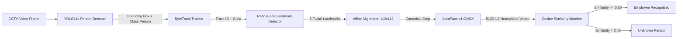

# Camera Intelligence — AI Engine Architecture & Pipeline Guide

**Document ID:** `docs/handover/AI_ENGINE_GUIDE.md`  
**Project Name:** Camera Intelligence  
**Environment Path:** `ai_engine/.venv`  
**Python Version:** 3.12.10 (64-bit)  
**Hardware Accelerated Provider:** NVIDIA CUDA 13.0 / TensorRT  
**GPU Tested:** NVIDIA GeForce RTX 3080 Desktop (10 GB VRAM)  

---

## 1. Overview & Pipeline Architecture

The **AI Engine** (`ai_engine/`) is the computer vision subsystem of Camera Intelligence. It operates in an isolated Python virtual environment (`ai_engine/.venv`) to prevent deep learning and CUDA dependency conflicts with backend ASGI/PostgreSQL libraries.



---

## 2. Model Inventory & Weight Assets

All AI models reside in the `ai_engine/models/` tree. Because these files are large binary weights, they must be transferred carefully:

| Model Component | Filename & Path | File Size | Origin / Architecture | Role in Pipeline |
| :--- | :--- | :---: | :--- | :--- |
| **YOLO11s** | `ai_engine/models/detection/yolo11s.pt` | 19.3 MB | Ultralytics YOLO11 (Small) | Real-time person detection (COCO class 0). |
| **ByteTrack** | Built-in via Ultralytics / `bytetrack.yaml` | N/A | Kalman Filter + Hungarian Matching | Multi-object tracking across sequential frames. |
| **RetinaFace ResNet34** | `ai_engine/models/face/retinaface_r34.pth` | 88.7 MB | ResNet-34 Backbone | High-accuracy face detection and 5 landmark points. |
| **RetinaFace MobileNet** | `ai_engine/third_party/retinaface-pytorch/weights/mobilenetv1_025.pretrained` | 1.95 MB | MobileNetV1 0.25 Backbone | Lightweight fallback face detector for CPU/edge. |
| **AuraFace v1** | `ai_engine/models/face/auraface_v1_glintr100.onnx` | 260.7 MB | Glintr100 ResNet-100 Architecture | 512-dimensional facial embedding feature extractor. |

---

## 3. Pipeline Stages & Algorithms

### Stage 1: Person Detection (YOLO11s)
- **Input:** Raw BGR video frame from camera stream.
- **Model:** `yolo11s.pt` executed via PyTorch CUDA.
- **Processing:** Filters detections strictly for `class_id = 0` (person) with confidence threshold $\ge 0.50$.
- **Output:** Bounding boxes $[x_1, y_1, x_2, y_2]$ and detection confidence.

### Stage 2: Temporal Tracking (ByteTrack)
- **Algorithm:** Two-stage association matching high-confidence and low-confidence boxes using Kalman filter state predictions.
- **Dependency:** `lap` package (Linear Assignment Problem solver).
- **Output:** Ephemeral `tracker_id` per video stream.
- **Safety Invariant:** `tracker_id` is never used as a persistent employee identity.

### Stage 3: Face Detection & Landmark Extraction (RetinaFace)
- **Model:** `retinaface_r34.pth` PyTorch weights.
- **Input:** Person upper-body region or full frame.
- **Output:** Bounding box for facial region and 5 landmark coordinates:
  - Left Eye: $(x_{le}, y_{le})$
  - Right Eye: $(x_{re}, y_{re})$
  - Nose Tip: $(x_n, y_n)$
  - Left Mouth Corner: $(x_{lm}, y_{lm})$
  - Right Mouth Corner: $(x_{rm}, y_{rm})$

### Stage 4: Canonical Face Alignment
- **Script:** `tests/test_face_alignment.py` and `tests/align_unknown_face.py`.
- **Target Coordinate Frame:** Standard ArcFace/InsightFace $112\times 112$ canonical reference:
  ```python
  REFERENCE_5PTS = [
      [38.2946, 51.6963],   # Left eye
      [73.5318, 51.5014],   # Right eye
      [56.0252, 71.7366],   # Nose
      [41.5493, 92.3655],   # Left mouth
      [70.7299, 92.2041]    # Right mouth
  ]
  ```
- **Transformation:** Computes similarity transform (rotation, scale, translation) via `cv2.estimateAffinePartial2D` and applies `cv2.warpAffine` to yield an aligned $112\times 112\times 3$ RGB image.

### Stage 5: 512D Embedding Generation (AuraFace v1)
- **Model:** `auraface_v1_glintr100.onnx`.
- **Engine:** ONNX Runtime GPU (`onnxruntime-gpu 1.31.1`) with CUDA Execution Provider.
- **Input Normalization:** Image converted from BGR to RGB, normalized to $[-1, 1]$ via $(x - 127.5) / 128.0$, transposed to $(1, 3, 112, 112)$ NCHW float32.
- **Output:** Raw 512-dimensional vector $\mathbf{v} \in \mathbb{R}^{512}$.
- **$L_2$ Normalization:**
  $$\hat{\mathbf{v}} = \frac{\mathbf{v}}{\sqrt{\sum_{i=1}^{512} v_i^2}}$$
  Enforces unit hypersphere representation where Euclidean distance and cosine similarity are directly related:
  $$\|\hat{\mathbf{u}} - \hat{\mathbf{v}}\|_2^2 = 2 - 2(\hat{\mathbf{u}} \cdot \hat{\mathbf{v}})$$

### Stage 6: Biometric Verification & Rejection
- **Comparison Metric:** Cosine similarity:
  $$S = \hat{\mathbf{u}} \cdot \hat{\mathbf{v}} = \sum_{i=1}^{512} u_i v_i$$
- **Decision Boundaries:**
  - $S \ge 0.60$: **Genuine Match** (`employee_recognized`, mapped to `employee_id`).
  - $0.45 \le S < 0.60$: **Ambiguous / Unverified** (buffered for multi-frame majority voting).
  - $S < 0.45$: **Unknown Person** (`unknown_person` event, potential guest or intruder).

---

## 4. Benchmark Results & Metric Evaluations

Evaluation data generated in `runs/face_recognition_batch_evaluation/` on genuine and impostor sets:

```text
Genuine Comparison:
  - Employee 001 verification face vs template: Cosine Similarity = 0.900373 (Match)

Impostor Comparison:
  - Unknown person verification face vs Employee 003: Cosine Similarity = 0.222668 (Rejected)
```

### ROC Metrics & Threshold Optimization
- At threshold $\tau = 0.50$:
  - **False Accept Rate (FAR):** $0.0000$ (0%)
  - **False Reject Rate (FRR):** $0.0000$ (0%)
  - **Separation Margin:** $\Delta S = 0.9003 - 0.2227 = 0.6776$ (Substantial margin preventing false matches).

### YOLO11s Inference Latency (RTX 3080)
- Execution: `tests/profile_yolo11s.py`
- Resolution: $854\times 480$ (CCTV Stream)
- Average Pre-processing Latency: $\sim 0.8$ ms
- Average GPU Inference Latency: $\sim 6.2$ ms
- Average Non-Maximum Suppression (NMS): $\sim 1.1$ ms
- **Total Frame Processing Time:** $\approx 8.1$ ms ($\sim 123$ FPS throughput potential).

---

## 5. Laptop vs. Desktop Environment Clarification

- **Repository Audit:** No separate laptop configuration or deployment scripts exist in this repository.
- **Verified Environment:** The primary development and benchmarking workstation is a Windows desktop configured with:
  - NVIDIA GeForce RTX 3080 (10 GB GDDR6X)
  - Python 3.12.10
  - CUDA 13.0
- **Laptop Migration Note:** If deploying to an NVIDIA-equipped laptop (e.g., RTX 3060/4060 Mobile), verify that PyTorch is installed with CUDA wheels (`cu124` or `cu130`) and that the laptop's dedicated GPU is selected rather than integrated Intel/AMD graphics. If deploying to a non-GPU laptop, configure ONNX Runtime with `CPUExecutionProvider`.

---

## 6. Distinction: Prototype Scripts vs. Phase 3 Production Services

| Component | Current Implementation State | Production Requirement (Phase 3) |
| :--- | :--- | :--- |
| **Stream Ingestion** | Local scripts read test MP4 files (`1.mp4`, `office_test.mp4`). | Persistent multi-threaded RTSP capture worker with auto-reconnect. |
| **Frame Processing** | Sequential evaluation in test scripts (`tests/test_detection.py`). | Asynchronous Producer-Consumer queue with frame dropping. |
| **Employee Templates** | Stored in static `.npz` archive (`runs/employee_enrollment/`). | Dynamic cache pre-loaded from backend `GET /face-enrollments`. |
| **Event Dissemination**| Terminal output and local CSV logs (`predictions.csv`). | Structured HTTP requests to backend `POST /api/v1/events`. |

