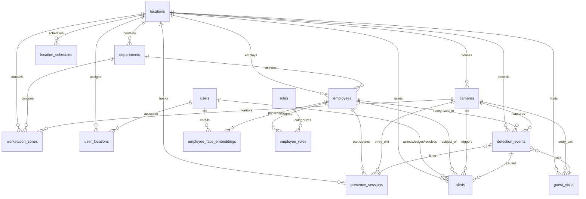

# Camera Intelligence — Database Architecture & Administration Guide

**Document ID:** `docs/handover/DATABASE_GUIDE.md`  
**Project Name:** Camera Intelligence  
**Database Name:** `camera_intelligence`  
**RDBMS Engine:** PostgreSQL 18.6 (64-bit on Windows)  
**Database Driver:** `psycopg` 3.3.9 binary (`postgresql+psycopg://`)  
**ORM:** SQLAlchemy 2.1.8  
**Migration Tool:** Alembic 1.20.1 (Current Revision: `573e887c33ec`)  

---

## 1. Connection Architecture & Configuration

The backend connects to PostgreSQL using connection pooling managed by SQLAlchemy in `server/app/database/session.py`.

### Connection String Format
```text
DATABASE_URL=postgresql+psycopg://<DB_USER>:<DB_PASSWORD>@<DB_HOST>:<DB_PORT>/<DB_NAME>
```

### Development Defaults
- **Host:** `localhost` (or `127.0.0.1`)
- **Port:** `5432`
- **Database:** `camera_intelligence`
- **User:** `postgres`
- **Password:** `<Configured during PostgreSQL installation>`

> [!IMPORTANT]
> The database connection string is read from the `server/.env` file. Never commit `.env` or hardcode database credentials in any documentation or repository file.

---

## 2. Table Inventory & Entity Relationships

The schema consists of **15 application tables** (13 entity models + 2 association tables) and 1 Alembic version tracking table (`alembic_version`), with a total of **40 foreign keys**.



---

## 3. Comprehensive Entity & Table Reference

### 3.1 `locations` Table
- **Model:** `Location` (`server/app/models/location.py`)
- **Purpose:** Primary physical facility or branch office.
- **Key Columns:** `id` (PK, Serial), `name` (VARCHAR(150), Unique), `address` (VARCHAR(255)), `timezone` (VARCHAR(50), default 'UTC'), `is_active` (BOOL), `created_at`, `updated_at`.

### 3.2 `departments` Table
- **Model:** `Department` (`server/app/models/department.py`)
- **Purpose:** Organizational unit within a specific location.
- **Key Columns:** `id` (PK), `location_id` (FK $\rightarrow$ `locations.id` ON DELETE CASCADE), `name` (VARCHAR(100)), `code` (VARCHAR(50)), `is_active` (BOOL).
- **Constraints:**
  - `uq_department_location_name`: Unique(`location_id`, `name`)
  - `uq_department_location_code`: Unique(`location_id`, `code`)

### 3.3 `roles` Table
- **Model:** `Role` (`server/app/models/role.py`)
- **Purpose:** Employee job title / operational role (e.g., Software Engineer, Security Officer).
- **Key Columns:** `id` (PK), `name` (VARCHAR(100), Unique), `description` (VARCHAR(255)).

### 3.4 `users` Table
- **Model:** `User` (`server/app/models/user.py`)
- **Purpose:** Administrative and operational user accounts with system roles.
- **Key Columns:** `id` (PK), `email` (VARCHAR(150), Unique), `full_name` (VARCHAR(150)), `password_hash` (VARCHAR(255)), `system_role` (VARCHAR(32)), `employee_id` (FK $\rightarrow$ `employees.id`, Unique, Nullable), `is_active` (BOOL), `last_login_at`.
- **Constraint:** `ck_user_system_role`: `system_role IN ('super_admin', 'location_admin', 'operator', 'viewer')`.

### 3.5 `user_locations` (Association Table)
- **Table:** `user_locations` (`server/app/models/user.py`)
- **Purpose:** Many-to-many assignment granting non-super-admins access to specific facilities.
- **Key Columns:** `user_id` (FK $\rightarrow$ `users.id` ON DELETE CASCADE), `location_id` (FK $\rightarrow$ `locations.id` ON DELETE CASCADE), `assigned_at` (TIMESTAMP). Primary Key: (`user_id`, `location_id`).

### 3.6 `employee_roles` (Association Table)
- **Table:** `employee_roles` (`server/app/models/role.py`)
- **Purpose:** Many-to-many assignment of job roles to employees.
- **Key Columns:** `employee_id` (FK $\rightarrow$ `employees.id` ON DELETE CASCADE), `role_id` (FK $\rightarrow$ `roles.id` ON DELETE CASCADE), `assigned_at` (TIMESTAMP). Primary Key: (`employee_id`, `role_id`).

### 3.7 `employees` Table
- **Model:** `Employee` (`server/app/models/employee.py`)
- **Purpose:** Employee personnel records and enrollment tracking.
- **Key Columns:** `id` (PK), `employee_code` (VARCHAR(50), Unique), `full_name` (VARCHAR(150)), `email` (VARCHAR(150), Unique), `department_id` (FK $\rightarrow$ `departments.id`), `location_id` (FK $\rightarrow$ `locations.id`), `enrollment_status` (VARCHAR(32)), `is_active` (BOOL).
- **Constraint:** `ck_employee_enrollment_status`: `enrollment_status IN ('pending', 'enrolled', 'needs_re_enroll', 'revoked')`.

### 3.8 `cameras` Table
- **Model:** `Camera` (`server/app/models/camera.py`)
- **Purpose:** IP CCTV cameras, stream ingestion parameters, and operational roles.
- **Key Columns:** `id` (PK), `camera_code` (VARCHAR(100), Unique), `name` (VARCHAR(150)), `location_id` (FK $\rightarrow$ `locations.id`), `camera_role` (VARCHAR(32)), `stream_type` (VARCHAR(32)), `connection_status` (VARCHAR(32)), `stream_uri` (VARCHAR(500)), `stream_secret_ref` (VARCHAR(255)), `is_active` (BOOL).
- **Constraints:**
  - `ck_camera_role`: `camera_role IN ('entry_exit', 'workstation', 'perimeter', 'general')`
  - `ck_camera_stream_type`: `stream_type IN ('rtsp', 'webcam', 'file', 'onvif')`
  - `ck_camera_connection_status`: `connection_status IN ('online', 'offline', 'degraded', 'unknown')`

### 3.9 `location_schedules` Table
- **Model:** `LocationSchedule` (`server/app/models/location_schedule.py`)
- **Purpose:** Facility operating hours per day of week with grace periods for after-hours detection.
- **Key Columns:** `id` (PK), `location_id` (FK $\rightarrow$ `locations.id`), `day_of_week` (INT, 0=Monday..6=Sunday), `open_time` (TIME), `close_time` (TIME), `grace_period_minutes` (INT, default 30), `is_workday` (BOOL).
- **Constraints:**
  - `ck_location_schedule_day`: `day_of_week >= 0 AND day_of_week <= 6`
  - `ck_location_schedule_grace`: `grace_period_minutes >= 0`
  - `uq_location_schedule_day`: Unique(`location_id`, `day_of_week`)

### 3.10 `workstation_zones` Table
- **Model:** `WorkstationZone` (`server/app/models/workstation_zone.py`)
- **Purpose:** Spatial polygon zone defining an employee workstation for seat occupancy and inactivity monitoring.
- **Key Columns:** `id` (PK), `location_id` (FK $\rightarrow$ `locations.id`), `camera_id` (FK $\rightarrow$ `cameras.id`), `zone_code` (VARCHAR(100), Unique), `name` (VARCHAR(150)), `polygon_points` (JSONB), `inactivity_threshold_seconds` (INT, default 900), `assigned_employee_id` (FK $\rightarrow$ `employees.id`, Nullable), `department_id` (FK $\rightarrow$ `departments.id`, Nullable), `is_active` (BOOL).
- **Constraint:** `ck_workstation_zone_inactivity_threshold`: `inactivity_threshold_seconds > 0`.

### 3.11 `employee_face_embeddings` Table
- **Model:** `EmployeeFaceEmbedding` (`server/app/models/employee_face_embedding.py`)
- **Purpose:** 512-dimensional facial biometric template vectors extracted by AuraFace.
- **Key Columns:** `id` (PK, BigInteger), `employee_id` (FK $\rightarrow$ `employees.id` ON DELETE CASCADE), `embedding` (`ARRAY(Float, dimensions=1)`), `model_name` (VARCHAR(100)), `model_version` (VARCHAR(32)), `is_template` (BOOL), `sample_count` (INT), `quality_score` (FLOAT), `is_active` (BOOL), `enrolled_by_user_id` (FK $\rightarrow$ `users.id`).
- **Constraints:**
  - `ck_employee_face_embedding_dim_512`: `array_length(embedding, 1) = 512`
  - `ck_employee_face_embedding_sample_count`: `sample_count >= 1`
- **Partial Unique Index:**
  - `uq_active_employee_template`: Unique(`employee_id`, `model_name`, `model_version`) WHERE `is_template = true AND is_active = true`.

### 3.12 `presence_sessions` Table
- **Model:** `PresenceSession` (`server/app/models/presence_session.py`)
- **Purpose:** Physical presence intervals for facility attendance and workstation desk activity.
- **Key Columns:** `id` (PK, BigInteger), `employee_id` (FK $\rightarrow$ `employees.id`), `location_id` (FK $\rightarrow$ `locations.id`), `entry_camera_id` (FK $\rightarrow$ `cameras.id`), `exit_camera_id` (FK $\rightarrow$ `cameras.id`), `workstation_zone_id` (FK $\rightarrow$ `workstation_zones.id`), `session_type` (VARCHAR(32)), `status` (VARCHAR(32)), `started_at` (TIMESTAMP), `last_seen_at` (TIMESTAMP), `ended_at` (TIMESTAMP), `active_seconds` (INT), `idle_seconds` (INT), `is_after_hours` (BOOL).
- **Constraints:**
  - `ck_presence_session_type`: `session_type IN ('facility', 'workstation')`
  - `ck_presence_session_status`: `status IN ('active', 'idle', 'closed')`
- **Partial Unique Indexes:**
  - `uq_open_facility_session_per_employee`: Unique(`employee_id`, `location_id`) WHERE `session_type = 'facility' AND ended_at IS NULL`.
  - `uq_open_workstation_session_per_employee`: Unique(`employee_id`, `workstation_zone_id`) WHERE `session_type = 'workstation' AND ended_at IS NULL`.

### 3.13 `guest_visits` Table
- **Model:** `GuestVisit` (`server/app/models/guest_visit.py`)
- **Purpose:** Audit tracking of visitor badges, entry/exit times, and host employee pairing.
- **Key Columns:** `id` (PK, BigInteger), `location_id` (FK $\rightarrow$ `locations.id`), `guest_code` (VARCHAR(64), Unique), `guest_name` (VARCHAR(150)), `entry_camera_id` (FK), `exit_camera_id` (FK), `host_employee_id` (FK), `status` (VARCHAR(32)), `entered_at`, `last_seen_at`, `exited_at`, `is_after_hours` (BOOL), `snapshot_ref`, `notes`.
- **Constraint:** `ck_guest_visit_status`: `status IN ('inside', 'exited', 'unverified', 'escalated')`.

### 3.14 `detection_events` Table
- **Model:** `DetectionEvent` (`server/app/models/detection_event.py`)
- **Purpose:** Immutable append-only telemetry events received from AI stream analytics.
- **Key Columns:** `id` (PK, BigInteger), `location_id` (FK $\rightarrow$ `locations.id`), `camera_id` (FK $\rightarrow$ `cameras.id`), `event_type` (VARCHAR(50)), `occurred_at` (TIMESTAMP), `employee_id` (FK, Nullable), `workstation_zone_id` (FK, Nullable), `presence_session_id` (FK, Nullable), `guest_visit_id` (FK, Nullable), `confidence` (FLOAT), `tracker_id` (VARCHAR(64), Nullable), `snapshot_ref` (VARCHAR(255), Nullable), `metadata_json` (JSONB, Nullable), `created_at`.
- **Constraint:** `ck_detection_event_type`:
  ```sql
  event_type IN (
      'employee_recognized',
      'unknown_person',
      'workstation_active',
      'workstation_idle',
      'after_hours_employee',
      'after_hours_intrusion',
      'guest_entry',
      'guest_exit'
  )
  ```

### 3.15 `alerts` Table
- **Model:** `Alert` (`server/app/models/alert.py`)
- **Purpose:** Security and operational anomaly alerts requiring human triage.
- **Key Columns:** `id` (PK, BigInteger), `location_id` (FK), `camera_id` (FK), `alert_type` (VARCHAR(50)), `severity` (VARCHAR(20)), `status` (VARCHAR(32)), `title` (VARCHAR(200)), `description` (VARCHAR(1000)), `employee_id` (FK), `workstation_zone_id` (FK), `detection_event_id` (FK), `triggered_at` (TIMESTAMP), `acknowledged_by_user_id` (FK $\rightarrow$ `users.id`), `acknowledged_at`, `resolved_by_user_id` (FK $\rightarrow$ `users.id`), `resolved_at`, `resolution_notes` (VARCHAR(500)).
- **Constraints:**
  - `ck_alert_type`: `alert_type IN ('employee_inactivity', 'after_hours_intrusion', 'after_hours_employee', 'unknown_guest', 'camera_offline')`
  - `ck_alert_severity`: `severity IN ('low', 'medium', 'high', 'critical')`
  - `ck_alert_status`: `status IN ('open', 'acknowledged', 'resolved', 'false_positive')`

---

## 4. Database Backup & Restore Procedure

### 4.1 Step 1: Create a Full Custom-Format Backup
Execute from PowerShell on the source machine:
```powershell
# Set PostgreSQL bin path if not in system PATH
$env:PATH += ";C:\Program Files\PostgreSQL\18\bin"

# Export custom-format archive (-F c) with blobs (-b) and verbose logging (-v)
pg_dump -U postgres -h localhost -p 5432 -d camera_intelligence -F c -b -v -f "C:\Users\PC\Desktop\camera_intelligence_backup.dump"
```
*(Enter the `postgres` user password when prompted).*

### 4.2 Step 2: Transfer the Backup File
Copy `camera_intelligence_backup.dump` to the new machine via secure drive, SCP, or network share.

### 4.3 Step 3: Restore to Target PostgreSQL on New Machine
Execute on the new machine:
```powershell
$env:PATH += ";C:\Program Files\PostgreSQL\18\bin"

# 1. Create target database
createdb -U postgres -h localhost -p 5432 camera_intelligence

# 2. Restore archive using pg_restore
pg_restore -U postgres -h localhost -p 5432 -d camera_intelligence -v --no-owner --no-acl "C:\path\to\camera_intelligence_backup.dump"
```

### 4.4 Step 4: Verify Database Parity
Run `.\run.ps1 db-check` or `.\run.ps1 migrate-status` to verify that all 15 tables exist and that Alembic reports head `573e887c33ec`.

