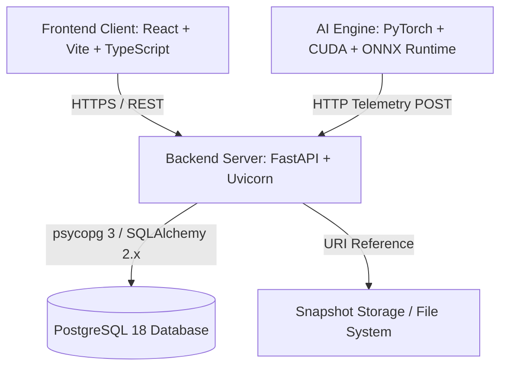
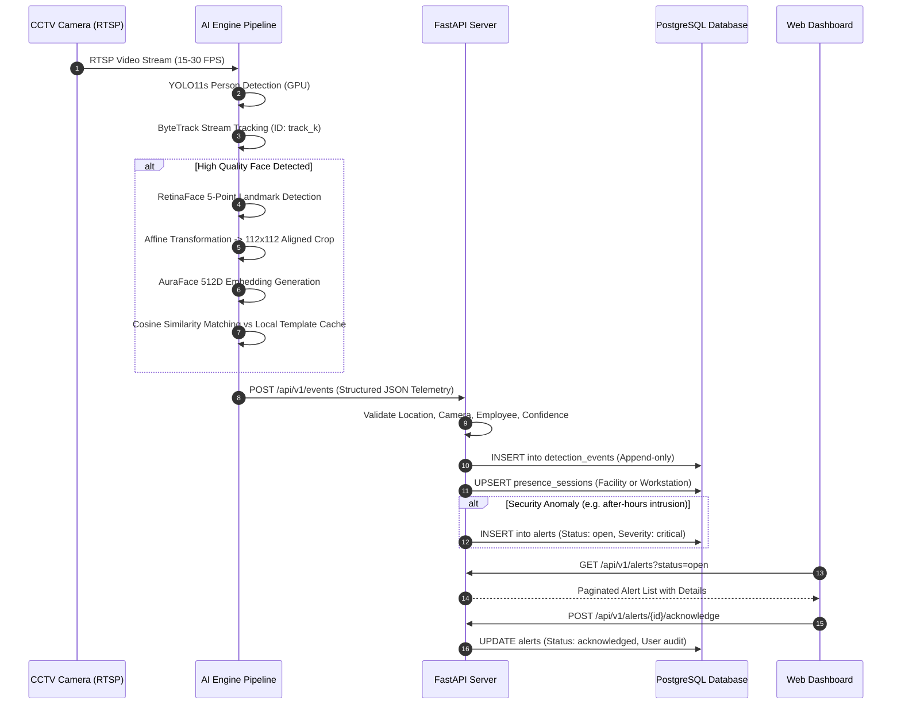
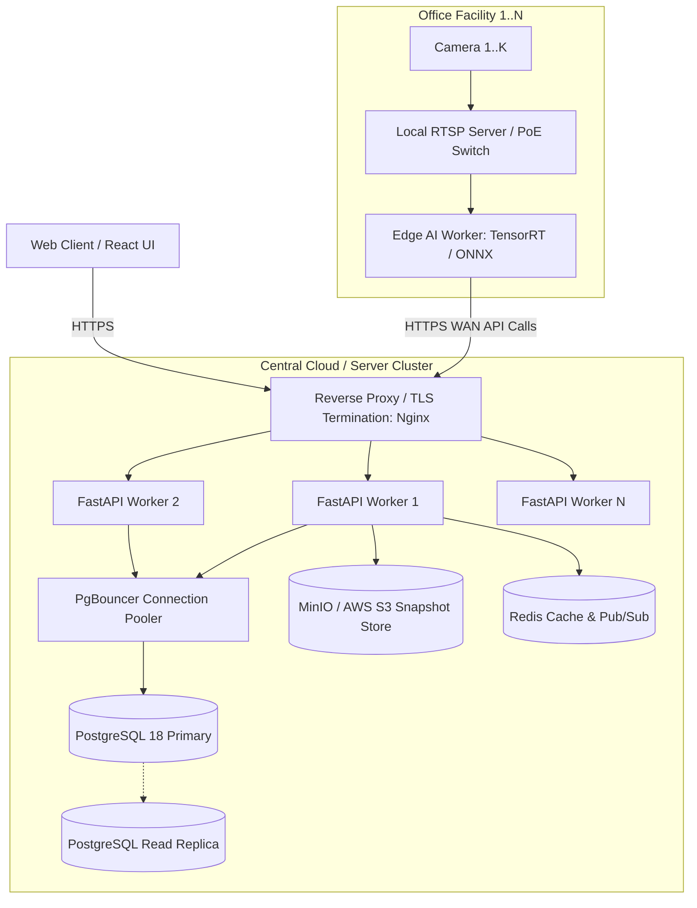

# Camera Intelligence — Project Master Context & Architecture

**Document ID:** `docs/handover/PROJECT_MASTER_CONTEXT.md`  
**Project Name:** Camera Intelligence  
**Author/Origin:** Antigravity Engineering Team  
**Handover Date:** November 2026  
**Status:** Phase 2 Complete (117 Tests Passing) | Transitioning to Phase 3  

---

## 1. Executive Summary & Purpose

**Camera Intelligence** is an enterprise-grade AI-powered physical workplace intelligence platform designed to transform commercial CCTV infrastructure (RTSP/ONVIF IP cameras) into an automated, privacy-conscious operational monitoring system.

### 1.1 The Problems It Solves
1. **Bottlenecked & Proxy-Prone Attendance:** Traditional fingerprint, card swipe, or facial biometric turnstiles create entrance queues and permit proxy clock-ins ("buddy punching") while failing to verify whether an employee remains on premises.
2. **Lack of In-Seat & Workstation Visibility:** Organizations have zero real-time visibility into actual workstation occupancy vs. prolonged inactivity, complicating capacity planning and shift accountability.
3. **Manual & Delayed Security Triage:** Traditional CCTV systems are passive recording archives requiring manual security guard review. Security breaches (after-hours intrusions, unknown persons in restricted zones) are identified hours after occurring.
4. **Unmonitored Guest Lifecycle:** Visitor badges are frequently lost or unreturned; organizations cannot audit guest presence, entry/exit times, or host employee pairings.

### 1.2 Main Objectives
- **Non-Intrusive Biometric Tracking:** Continuously detect, track, and verify employee presence across facility zones without requiring manual interaction.
- **Multi-Tenant / Multi-Location Management:** Provide a unified platform supporting multiple geographic offices, floors, and departments with strict location-scoped role-based access control (RBAC).
- **Automated Anomaly Detection & Alerts:** Generate instant operational alerts for employee inactivity, after-hours facility presence, perimeter intrusions, and camera offline events.
- **Biometric Security & Privacy by Design:** Enforce strict mathematical normalization on embeddings, strip raw facial vectors from API responses, and never store raw video frames in application databases.

---

## 2. User Roles & Personas

The system enforces a 4-tier Role-Based Access Control (RBAC) hierarchy defined in `server/app/core/permissions.py`:

```
super_admin (Level 40)
       │
location_admin (Level 30)
       │
    operator (Level 20)
       │
     viewer (Level 10)
```

| System Role | Scope | Primary Responsibilities | Permissions & Capabilities |
| :--- | :--- | :--- | :--- |
| **`super_admin`** | Global (all locations) | System owner, corporate IT director, chief security officer | Full global CRUD on locations, users, system settings, global alerts, cameras, employees, and templates. |
| **`location_admin`** | Assigned locations only | Branch manager, facility director | Full CRUD on cameras, workstation zones, schedules, departments, employees, and face enrollments within assigned facilities. |
| **`operator`** | Assigned locations only | Security desk guard, SOC monitoring operator | Operational event ingestion, alert triage, alert acknowledgment, alert resolution, real-time telemetry inspection. |
| **`viewer`** | Assigned locations only | Auditor, department head, HR executive | Read-only access to presence sessions, analytics, event logs, camera statuses, and alert histories. Cannot modify or triage. |

---

## 3. Planned vs. Implemented Feature Matrix

| Feature Domain | Feature Description | Status | Implementation Details |
| :--- | :--- | :--- | :--- |
| **Authentication & RBAC** | JWT authentication, password hashing, 4-tier RBAC | **Implemented & Verified** | Argon2id hashing, 60-min JWT, `user_locations` scoping (15 tests passing). |
| **Location Management** | Multi-facility CRUD, timezone awareness, soft deactivation | **Implemented & Verified** | Location-scoped queries, timezone validation (Management APIs). |
| **Department Management** | Unique department codes per facility, organizational tree | **Implemented & Verified** | Enforces composite unique constraints (`location_id`, `name`/`code`). |
| **Employee Management** | Employee profiles, job role assignment, status lifecycle | **Implemented & Verified** | Cross-location validation, enrollment state machine (`pending`, `enrolled`, `needs_re_enroll`). |
| **Camera Management** | Camera registry, RTSP stream metadata, role assignment | **Implemented & Verified** | Roles: `entry_exit`, `workstation`, `perimeter`, `general`. Secret references sanitized. |
| **Workstation Zones** | Spatial polygon zones, inactivity thresholds, employee assignments | **Implemented & Verified** | Normalized $[[x, y], ...]$ polygons ($\ge 3$ vertices), assigned employee location checks. |
| **Location Schedules** | Weekly operating hours, open/close times, grace periods | **Implemented & Verified** | Day-of-week validation (0-6), overnight schedule support, timezone calculation. |
| **Face Enrollment APIs** | 512D AuraFace biometric template enrollment & metadata | **Implemented & Verified** | Strict dimension ($512$), finite float, $L_2$-norm ($[0.95, 1.05]$) validation, atomic `/set-primary`. |
| **Detection Event Telemetry** | Append-only event ingestion, stream telemetry tracking | **Implemented & Verified** | Validates 8 check-constraint event types, bounds $[0.0, 1.0]$, ephemeral tracker IDs. |
| **Alert Management** | Security alert creation, acknowledgment, resolution lifecycle | **Implemented & Verified** | State machine (`open` $\rightarrow$ `acknowledged` $\rightarrow$ `resolved`/`false_positive`), audit trails. |
| **Presence & Guest Linking** | Automated facility/workstation presence sessions, guest visits | **Implemented & Verified** | Event-driven session starts/updates, automated critical alert triggers for intrusions. |
| **Live RTSP Stream Manager** | OpenCV / PyAV multi-stream frame capture and buffering | **Planned (Phase 3)** | Standalone prototypes in `tests/test_streaming_tracking.py`; service pipeline deferred. |
| **Real-Time Video Analytics** | Continuous GPU inference on live RTSP feeds | **Planned (Phase 3)** | YOLO11s + ByteTrack + RetinaFace + AuraFace verified on static inputs/benchmarks. |
| **Optical Flow Inactivity** | Pixel-level movement analysis inside workstation polygons | **Planned (Phase 3)** | Algorithm verified; live frame worker deferred to Phase 3. |
| **Web Frontend UI** | React + Vite administrative dashboard, live video wall | **Planned (Phase 4)** | Scaffolding in `client/`; API client and component library to be authored. |
| **WebSocket / SSE Alerts** | Push notifications for open alerts to SOC screens | **Planned (Phase 3/5)**| REST polling supported; real-time broadcast planned with Redis pub/sub. |

---

## 4. Complete Technology Stack



### 4.1 Backend (`server/`)
- **Framework:** FastAPI 0.162.5 (Asynchronous ASGI framework, OpenAPI 3.1 documentation).
- **Server:** Uvicorn 0.54.0 (Standard workers with uvloop and httptools).
- **ORM:** SQLAlchemy 2.1.8 (Declarative Mapped 2.0 syntax, type-annotated models).
- **Database Driver:** `psycopg` 3.3.9 binary (Modern Python-PostgreSQL adapter with native composite types).
- **Migrations:** Alembic 1.20.1 (Transactional schema migrations, revision tracking).
- **Password Security:** `pwdlib` 0.3.1 with Argon2id (`argon2-cffi` 25.1.0).
- **Token Security:** `python-jose` 3.5.0 (HS256 JWT tokens with exp, sub, and role claims).
- **Validation:** Pydantic v2 (2.14.3) and Pydantic-Settings (2.16.2).

### 4.2 Database (`PostgreSQL 18.6`)
- **Engine:** PostgreSQL 18.6 64-bit on Windows.
- **Relational Schema:** 15 application tables (13 entity tables, 2 association tables).
- **Biometric Storage:** Native PostgreSQL `ARRAY(Float, dimensions=1)` check-constrained to exactly 512 dimensions (`ck_employee_face_embedding_dim_512`).
- **Telemetry Storage:** Native `JSONB` for workstation polygons (`polygon_points`) and telemetry payloads (`metadata_json`).
- **Partial Unique Indexing:** PostgreSQL conditional indexes enforcing business invariants:
  - At most 1 active biometric template per employee/model/version.
  - At most 1 open facility presence session per employee per facility.
  - At most 1 open workstation presence session per employee per zone.

### 4.3 AI Engine (`ai_engine/`)
- **Runtime:** Python 3.12.10 64-bit with NVIDIA CUDA 13.0.
- **Deep Learning Framework:** PyTorch 2.14.1+cu130 with `torchvision` 0.29.1+cu130.
- **Inference Acceleration:** ONNX Runtime GPU 1.31.1 (`TensorrtExecutionProvider`, `CUDAExecutionProvider`).
- **Object Detection:** Ultralytics YOLO11s (`yolo11s.pt`, 19.3 MB, COCO class 0: Person).
- **Object Tracking:** ByteTrack (Kalman filter + Hungarian linear assignment via `lap` 0.5.14).
- **Face Detection & Alignment:** RetinaFace ResNet34 (`retinaface_r34.pth`, 88.7 MB) with 5 facial landmarks (eyes, nose, mouth corners) computing affine similarity transforms to 112x112 crops.
- **Face Feature Extraction:** AuraFace v1 (`auraface_v1_glintr100.onnx`, 260.7 MB) producing 512-dimensional $L_2$-normalized feature vectors.
- **Computer Vision:** OpenCV (`opencv-python` 5.0.0.93) for image transformations and video decoding.

### 4.4 Hardware Environment (Primary Benchmark Machine)
- **Host GPU:** NVIDIA GeForce RTX 3080 Desktop (10 GB GDDR6X VRAM).
- **Host OS:** Windows 10/11 Pro 64-bit.
- **Host RAM:** 32+ GB DDR4/DDR5.
- **Compute Capability:** CUDA 8.6 (Ampere Architecture).

---

## 5. System Architecture & Communication Flow



---

## 6. CCTV Processing Workflow (Step-by-Step)

1. **Stream Acquisition:** The camera stream manager acquires frames via RTSP/ONVIF. Frames are pre-sampled (e.g. 5–10 FPS for analytics, bypassing redundant decoding).
2. **Person Bounding Box Detection:** YOLO11s evaluates the frame on GPU, isolating all bounding boxes corresponding to `class_id = 0` (person) with confidence $\ge 0.50$.
3. **Multi-Frame Tracking:** ByteTrack maps person bounding boxes across sequential frames, maintaining an ephemeral `tracker_id`.
4. **Facial Landmark Detection:** For each tracked person, if the head/face resolution is sufficient ($\ge 40\times 40$ pixels), RetinaFace ResNet34 extracts 5 facial landmarks.
5. **Face Alignment:** Landmark coordinates compute an affine similarity transform warping the face into a standardized $112\times 112$ canonical crop.
6. **Feature Extraction:** The canonical crop passes through `auraface_v1_glintr100.onnx`, generating a raw 512-dimensional vector that is immediately $L_2$-normalized:
   $$\hat{\mathbf{v}} = \frac{\mathbf{v}}{\|\mathbf{v}\|_2}$$
7. **Biometric Verification:** The vector is evaluated against pre-cached enrolled employee templates via cosine similarity:
   $$\text{Sim}(\mathbf{u}, \mathbf{v}) = \mathbf{u} \cdot \mathbf{v}$$
   - If $\max(\text{Sim}) \ge 0.60$: The person is classified as `employee_recognized` with the matched `employee_id`.
   - If $\max(\text{Sim}) < 0.45$: The person is classified as `unknown_person`.
   - Between $0.45$ and $0.60$: Ambiguous threshold; marked as unverified pending multi-frame confirmation.
8. **Workstation Polygon Check:** For workstation cameras, the bottom-center of the person bounding box is tested against defined zone polygon coordinates using Ray-Casting algorithm. If inside, event is marked `workstation_active`.
9. **Backend Telemetry Ingestion:** A structured payload is dispatched to `POST /api/v1/events`. Raw video frames are discarded; optional snapshot JPEG files are stored to local/S3 storage with URI paths referenced in `snapshot_ref`.
10. **State Machine & Alert Triggering:** The backend records the event, updates presence sessions, and generates security alerts if operating hours or boundary rules are violated.

---

## 7. Production Deployment Architecture



- **Separation of Concerns:** Edge devices run lightweight inference pipelines sending compact JSON payloads; central servers manage business logic, state machines, and relational storage.
- **Fail-Safe Operation:** If the network connection between an office edge and central backend drops, edge workers buffer detection events locally in SQLite and replay them once connectivity is restored.
- **Database Scalability:** Write-heavy telemetry events use append-only partitions, while read-heavy dashboards query read replicas through PgBouncer.

