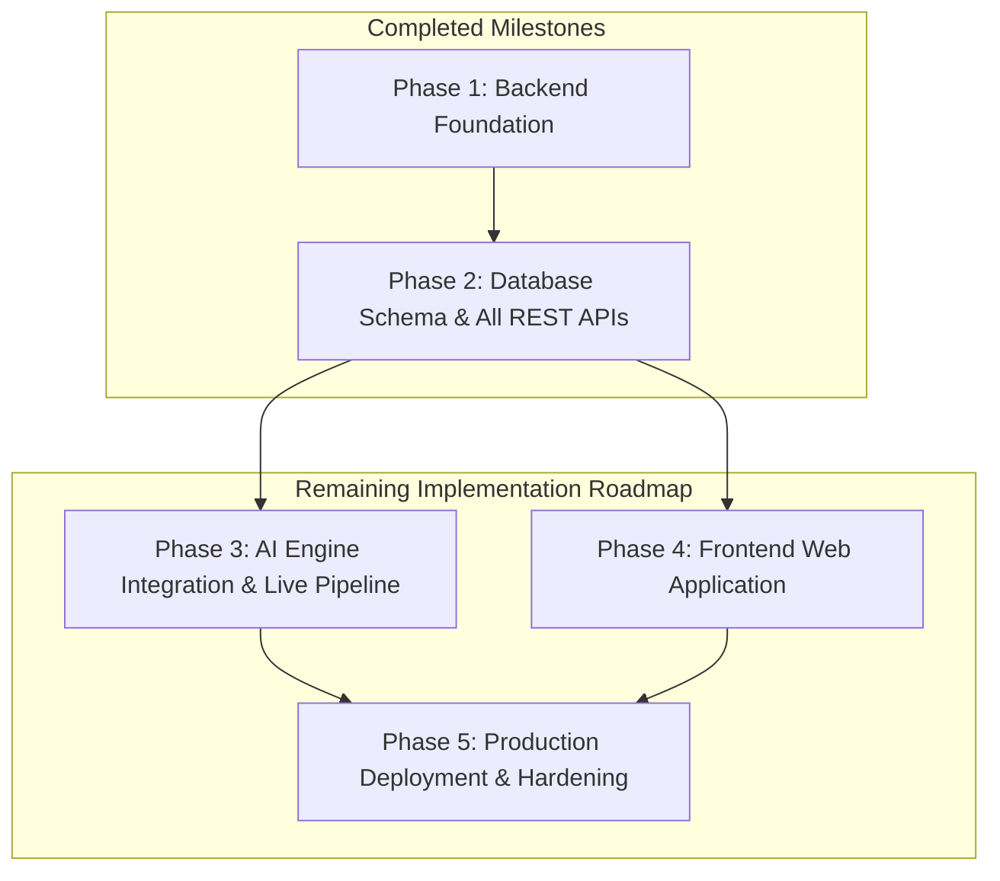

# Camera Intelligence — Remaining Development Roadmap

**Document ID:** `docs/handover/REMAINING_ROADMAP.md`  
**Current Progress:** Phase 1 & Phase 2 Complete (100% of Backend Foundation & REST APIs)  
**Next Immediate Milestone:** Phase 3 — AI Engine Integration  

---

## 1. Roadmap Architecture Overview

---

## 2. Phase 3: AI Engine Integration & Live Pipeline

Phase 3 transforms the standalone AI evaluation prototypes into a production-grade asynchronous computer vision worker service that continuously ingests RTSP streams, processes video frames on GPU, and posts structured detection telemetry to the backend API.

### Task 3.1: RTSP Camera Stream Manager & Ingestion Worker
- **Objective:** Build a resilient RTSP capture worker capable of decoding live camera streams with automatic reconnection on network drops.
- **Dependencies:** OpenCV / PyAV, backend camera registry (`GET /api/v1/cameras`).
- **Target Files:** `ai_engine/services/stream_manager.py`, `ai_engine/services/rtsp_worker.py`.
- **Implementation Details:**
  - Multi-threaded video capture running in background threads.
  - Frame sampling queue: decodes at stream rate but samples 5–10 FPS for GPU inference to prevent frame backlog.
  - Connection health watchdog monitoring RTSP stream drops and updating `camera.connection_status` (`online` / `offline`).
- **Acceptance Criteria:**
  - Sustained continuous ingestion from multiple RTSP streams without memory leaks.
  - Automatic reconnection within 5 seconds of stream disruption.

### Task 3.2: Unified GPU Inference Pipeline (YOLO + ByteTrack + RetinaFace + AuraFace)
- **Objective:** Chain the 4 verified computer vision models into an optimized sequential GPU pipeline.
- **Dependencies:** PyTorch CUDA, ONNX Runtime GPU, `ai_engine/models/`.
- **Target Files:** `ai_engine/pipeline/detector.py`, `ai_engine/pipeline/tracker.py`, `ai_engine/pipeline/recognizer.py`.
- **Implementation Details:**
  1. YOLO11s evaluates sampled frame $\rightarrow$ detects person bounding boxes.
  2. ByteTrack updates Kalman filter state $\rightarrow$ assigns stream `tracker_id`.
  3. RetinaFace detects faces within person crops $\rightarrow$ extracts 5 facial landmarks.
  4. Affine alignment warps face to canonical $112\times 112$ crop.
  5. AuraFace extracts 512D vector $\rightarrow L_2$ normalizes embedding.
  6. Cosine similarity evaluates embedding against local cached employee templates.
- **Acceptance Criteria:**
  - Total inference latency $\le 30$ ms per frame on RTX 3080.
  - Zero crashes on low-resolution, blurred, or occluded faces.

### Task 3.3: Workstation Zone Occupancy & Inactivity Analyzer
- **Objective:** Track employee presence inside spatial workstation zones and detect prolonged seat inactivity.
- **Dependencies:** `server/app/models/workstation_zone.py`, OpenCV.
- **Target Files:** `ai_engine/analytics/zone_analyzer.py`, `ai_engine/analytics/inactivity_detector.py`.
- **Implementation Details:**
  - Ray-Casting algorithm to test person bounding box base point $(x_{base}, y_{base})$ against normalized polygon coordinates.
  - Optical flow / frame differencing within workstation bounding box to monitor keyboard, mouse, and physical movement.
  - Accumulated inactivity counter triggering `workstation_idle` events when inactivity exceeds `inactivity_threshold_seconds`.
- **Acceptance Criteria:**
  - Accurate spatial containment inside complex polygon shapes.
  - Generates `workstation_active` when movement is present, transitioning to `workstation_idle` after threshold expiration.

### Task 3.4: Event Telemetry Generator & Backend Ingestion Client
- **Objective:** Format and dispatch verified computer vision events to the backend REST API (`POST /api/v1/events`).
- **Dependencies:** Backend API endpoints, `requests` / `httpx`.
- **Target Files:** `ai_engine/services/event_dispatcher.py`.
- **Implementation Details:**
  - Asynchronous HTTP client posting `DetectionEventCreate` payloads with token authentication.
  - Local SQLite buffer for offline queuing during temporary network outages.
  - Optional visual snapshot writer saving JPEG crops to `storage/snapshots/` and passing relative paths in `snapshot_ref`.
- **Acceptance Criteria:**
  - Events successfully ingested and visible in backend database.
  - Automated alerts generated on `after_hours_intrusion`.

---

## 3. Phase 4: Frontend Web Application (`client/`)

Phase 4 builds a modern, responsive web application for security operators, facility managers, and administrators.

### Task 4.1: Project Initialization & Authentication UI
- **Objective:** Scaffold React 18 + TypeScript + Vite in `client/` and build secure JWT authentication.
- **Dependencies:** Vite, React Router, TailwindCSS / Shadcn UI, Axios.
- **Target Files:** `client/src/App.tsx`, `client/src/pages/Login.tsx`, `client/src/services/api.ts`.
- **Features:**
  - Clean login screen, JWT token storage in memory/secure cookie, automatic redirection.
  - Global Axios interceptor injecting `Authorization: Bearer <token>` and handling 401 token expiry.

### Task 4.2: Role-Based Dashboard & Facility Overview
- **Objective:** Build the primary monitoring dashboard displaying live occupancy telemetry.
- **Target Files:** `client/src/pages/Dashboard.tsx`, `client/src/components/MetricCard.tsx`.
- **Features:**
  - Real-time counts: Working Employees Present, Active Workstations, Open Alerts, Guest Count.
  - Location selector dropdown (automatically scoped based on user role).

### Task 4.3: Interactive Workstation Zone Polygon Editor
- **Objective:** Visual polygon drawing tool over camera snapshots.
- **Target Files:** `client/src/pages/ZoneEditor.tsx`, `client/src/components/PolygonCanvas.tsx`.
- **Features:**
  - HTML5 Canvas overlay on camera frame snapshot.
  - Click-to-add polygon vertices with normalized $[[x, y], ...]$ coordinate output.
  - Form to set zone name, inactivity threshold (seconds), and assigned employee.

### Task 4.4: Employee Management & Face Enrollment Interface
- **Objective:** Web interface for managing employees and capturing/uploading face templates.
- **Target Files:** `client/src/pages/Employees.tsx`, `client/src/pages/FaceEnrollmentModal.tsx`.
- **Features:**
  - Paginated employee list with search and filter by department.
  - Face enrollment wizard: upload facial photos, display alignment preview, submit to enrollment API.

### Task 4.5: Live Security Alert Triage & Event History Log
- **Objective:** Operational console for security guards and operators.
- **Target Files:** `client/src/pages/Alerts.tsx`, `client/src/pages/EventLog.tsx`.
- **Features:**
  - Color-coded alert badges by severity (`critical`, `high`, `medium`, `low`).
  - Action buttons: "Acknowledge" and "Resolve" with resolution notes dialog.
  - Paginated audit log of detection events with snapshot thumbnail previews.

---

## 4. Phase 5: Production Deployment & Hardening

### Task 5.1: Real-Time WebSocket / SSE Push Notifications
- **Objective:** Replace REST polling with real-time push for instant alert dispatching to operator screens.
- **Implementation:** FastAPI WebSocket endpoint (`/ws/alerts`) with Redis Pub/Sub broadcast.

### Task 5.2: Production Docker Compose Configuration
- **Objective:** Containerize all system components for multi-platform deployment.
- **Target Files:** `docker-compose.yml`, `server/Dockerfile`, `client/Dockerfile`.
- **Services:** FastAPI backend, React Nginx frontend, PostgreSQL 16 container, Redis container.

### Task 5.3: Security Hardening & Edge Optimization
- **Objective:** Ensure enterprise compliance, HTTPS/TLS encryption, and TensorRT engine optimization.
- **Implementation:**
  - Convert `auraface_v1_glintr100.onnx` to TensorRT engine for 3x throughput improvement.
  - Configure TLS termination with Let's Encrypt / custom certs on Nginx.
  - Enforce database connection encryption and snapshot storage encryption at rest.

---

## 5. Implementation Priority & Sequential Execution Order

| Step | Milestone | Task | Dependencies | Estimated Complexity |
| :---: | :--- | :--- | :--- | :---: |
| **1** | Phase 3 | Task 3.1: RTSP Stream Ingestion Worker | Backend Camera API | Medium |
| **2** | Phase 3 | Task 3.2: Unified GPU Inference Pipeline | Models & CUDA | High |
| **3** | Phase 3 | Task 3.3: Workstation & Inactivity Analyzer | Pipeline & Zones | Medium |
| **4** | Phase 3 | Task 3.4: Event Telemetry Ingestion Client | Task 3.2, 3.3 | Medium |
| **5** | Phase 4 | Task 4.1: React Frontend Setup & Login UI | Auth REST API | Low |
| **6** | Phase 4 | Task 4.2: Dashboard & Metric Cards | Location APIs | Medium |
| **7** | Phase 4 | Task 4.3: Visual Polygon Zone Editor | Zone APIs | High |
| **8** | Phase 4 | Task 4.4: Employee & Face Enrollment UI | Enrollment APIs | Medium |
| **9** | Phase 4 | Task 4.5: Alert Triage Console | Alert APIs | Medium |
| **10**| Phase 5 | Task 5.1: WebSocket Alert Dispatch | Redis / FastAPI | Medium |
| **11**| Phase 5 | Task 5.2: Production Docker Compose | All Services | Medium |

