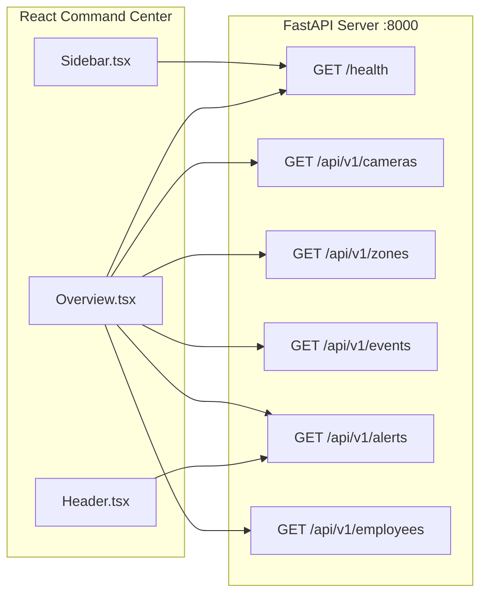

# Frontend Phase 1.1 — Authentic Backend State & Mock Removal Report

**Date:** 2026-11-16  
**Status:** Complete & Verified  
**Scope:** `client/src/pages/Overview.tsx`, `client/src/components/layout/Header.tsx`, `client/src/components/layout/Sidebar.tsx`, `client/src/services/`  

---

## 1. Executive Summary

In Frontend Phase 1.1, all fabricated metrics, hardcoded fallback numbers, fake alert badges, simulated camera records, and synthetic GPU/node statuses were audited and completely removed from the Camera Intelligence command-center frontend. 

The frontend now exclusively binds to genuine FastAPI endpoints (`/health`, `/api/v1/cameras`, `/api/v1/zones`, `/api/v1/events`, `/api/v1/alerts`, `/api/v1/employees`), and enforces honest UI states:
- **0 is only shown when the backend returns 0 records.**
- **Loading states** are clearly rendered while asynchronous queries are in flight.
- **Informative empty states** are presented when tables, event streams, or alert queues are empty.
- **Unambiguous error indicators and retry triggers** are displayed when backend network calls fail.
- **Missing backend endpoints** (e.g., presence sessions, edge daemon GPU metrics bridge) are explicitly labeled rather than faked.

Both the linter (`oxlint`) and TypeScript compiler/bundler (`tsc -b && vite build`) passed with **0 errors and 0 warnings**.

---

## 2. Audit of Removed Mock & Fabricated Data

| Component | Removed Fabricated Logic | Replacement / Authentic State |
|---|---|---|
| **Overview.tsx** | `isDemoFallback` mode flag and synthetic data generator | Removed entirely. All components query backend services via TanStack Query. |
| **Overview.tsx** | Hardcoded KPI fallback numbers (`12` cameras, `48` employees, `1` critical alert, etc.) | Actual counts derived from `GET /api/v1/*` responses (`.total` or filtered `.length`). |
| **Overview.tsx** | Fake 24-hour activity timeline array (`activityTimelineData`) | Dynamically calculated from genuine ingested detection event timestamps (`occurred_at` / `created_at`), or an informative empty state if no events exist. |
| **Overview.tsx** | Fabricated camera fleet records (`CAM-01 Lobby`, `CAM-02 Back Entrance`, fake FPS `25.0`, `18.5`) | Genuine records from `GET /api/v1/cameras` showing actual `camera_code`, `stream_type`, `camera_role`, and `connection_status`. |
| **Overview.tsx** | Fabricated detection events ("Dr. Jane Smith", "Unidentified Person #842", fake confidences) | Genuine detection records from `GET /api/v1/events` displaying actual `event_type`, `camera_id`, `employee_id`, and `occurred_at`. |
| **Overview.tsx** | Static GPU hardware specs (`RTX 3060`, `~18ms`, `5.0 FPS`) | Static architectural pipeline specifications (YOLO11s, ByteTrack, RetinaFace, AuraFace, SQLite WAL) with live metrics honestly marked as `DAEMON BRIDGE PENDING`. |
| **Header.tsx** | Static notification badge `2` and hardcoded alert items | Dynamic badge and alert list backed by `eventService.getAlerts({ status: 'open' })`. Badge hides completely when `count === 0`. |
| **Sidebar.tsx** | Hardcoded `SYSTEM ACTIVE` pulsing dot, `NODE: WS-EDGE-01`, and `CUDA READY` | Real-time health polling via `systemService.getHealth()`, rendering `BACKEND ONLINE` (green), `CHECKING...` (amber), or `BACKEND OFFLINE` (red). |

---

## 3. Endpoints Utilized & Backend Contract Mapping

The frontend binds strictly to existing FastAPI backend endpoints defined in `server/app/api/v1/router.py`:



### Exact Endpoint Contracts

1. **`GET /health`**
   - Returns: `{ "status": "healthy", "application": "Camera Intelligence", "version": "1.0.0" }`
   - Consumed by: [Sidebar.tsx](file:///c:/Users/user10/Desktop/Camera_Intelligence/camera_intelligence/client/src/components/layout/Sidebar.tsx) and [Overview.tsx](file:///c:/Users/user10/Desktop/Camera_Intelligence/camera_intelligence/client/src/pages/Overview.tsx).
2. **`GET /api/v1/cameras`**
   - Returns: `PaginatedResponse<CameraOut>` (`items`, `total`, `page`, `size`, `pages`).
   - Fields displayed: `camera_code`, `name`, `camera_role`, `stream_type`, `connection_status`, `last_heartbeat_at`.
3. **`GET /api/v1/zones`**
   - Returns: `PaginatedResponse<WorkstationZoneOut>`.
   - Used to compute total workstation zones and active zone counts.
4. **`GET /api/v1/events`**
   - Filter `event_type=unknown_person` used to count unverified intruders.
   - Filter `page=1&size=10` used for the live recent detections feed and hourly timeline bucket aggregation.
5. **`GET /api/v1/alerts`**
   - Filter `status=open&size=10` used for the active security alert card and Header notification bell.
6. **`GET /api/v1/employees`**
   - Service added: [employeeService.ts](file:///c:/Users/user10/Desktop/Camera_Intelligence/camera_intelligence/client/src/services/employeeService.ts) querying `GET /api/v1/employees?is_active=true`.
   - Displays authentic enrolled workforce count.

---

## 4. Honest Handling of Missing Backend Capabilities

During backend contract inspection, two infrastructure gaps were identified where backend routers do not yet exist:

1. **Presence Sessions (`PresenceSession` Model):**
   - *Status:* The SQLAlchemy model exists in the database schema (`presence_sessions` table), but no router or GET endpoint is exposed in `server/app/api/v1/router.py`.
   - *Honest UI Handling:* Rather than simulating live workstation occupancy or attendance numbers, the KPI card shows total registered employees and explicitly displays `PRESENCE API: N/A` with tooltip context.
2. **Edge Ingestion Service Telemetry WebSocket / HTTP Bridge:**
   - *Status:* The Python AI Engine runs as an independent daemon. There is currently no backend proxy endpoint streaming live GPU VRAM, inference latency, or per-camera FPS to the client web browser.
   - *Honest UI Handling:* Replaced fabricated FPS / GPU meters with an **AI Pipeline Architecture Specification Card** detailing the active neural architectures (YOLO11s, ByteTrack, RetinaFace ResNet34, AuraFace 512D, Farneback Optical Flow, SQLite WAL Persistent Queue) and explicitly labeling live GPU metrics as `DAEMON BRIDGE PENDING`.

---

## 5. Build and Linter Verification

Both verification checks passed with zero errors or warnings:

### Linter (`oxlint`)
```
> client@0.0.0 lint
> oxlint

Found 0 warnings and 0 errors.
Finished in 24ms on 21 files with 116 rules using 12 threads.
```

### Production Build (`tsc -b && vite build`)
```
> client@0.0.0 build
> tsc -b && vite build

vite v8.3.8 building client environment for production...
transforming...
✓ 2586 modules transformed.
rendering chunks...
computing gzip size...
dist/index.html                   0.66 kB │ gzip:   0.42 kB
dist/assets/index-BQj5tbeH.css   30.50 kB │ gzip:   6.40 kB
dist/assets/index-GSpXGkVB.js   798.36 kB │ gzip: 241.28 kB

✓ built in 364ms
```

---

## 6. Verification Status & Next Phase Readiness

- [x] All mock data arrays and `isDemoFallback` logic excised.
- [x] Empty, loading, and error states implemented with honest visual feedback.
- [x] Header alert bell tied to live open alerts with badge autohide on 0 alerts.
- [x] Sidebar system status tied to live `/health` API.
- [x] Production build and strict linting pass with 0 warnings.
- [x] Ready to proceed to **Phase 2 (Cameras & Live Streams)** or subsequent modules as directed by the user.
