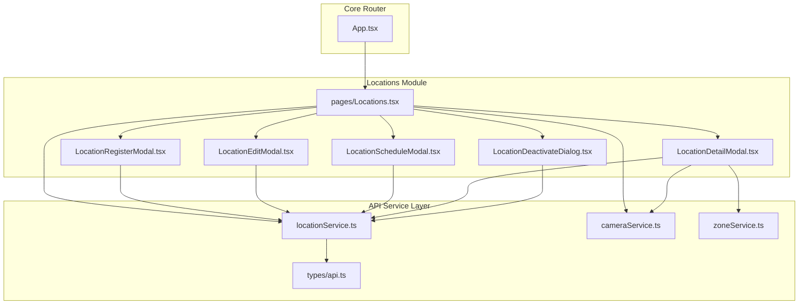
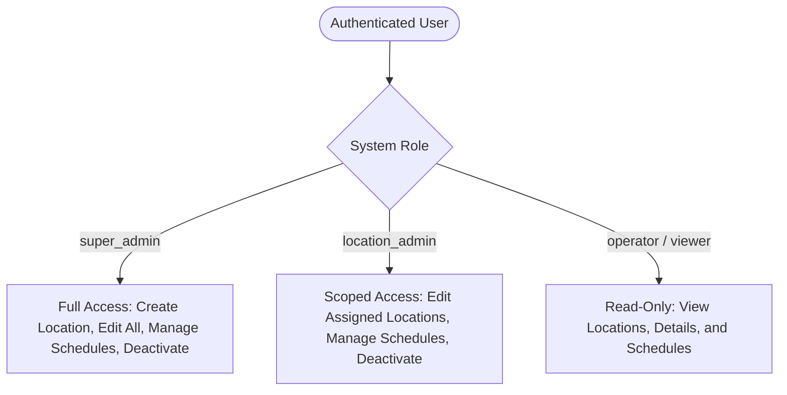

# Phase 3: Locations & Facilities Management UI — Implementation Report

**Date:** 2026-11-16  
**Status:** Complete & Verified  
**Scope:** `client/src/pages/Locations.tsx`, `client/src/components/locations/*`, `client/src/services/locationService.ts`, `client/src/types/api.ts`, `client/src/App.tsx`  

---

## 1. Executive Summary

Phase 3 delivered the complete **Locations & Facilities Management** module in the Camera Intelligence enterprise security command center. 

The module is integrated directly with the FastAPI backend without synthetic or mock data:
- **Multi-Facility Topology Dashboard:** Displays authentic facility counts (Total Campuses, Active Operational, Suspended Inactive, and Total CCTV Sensors across locations) derived from real backend queries.
- **Search & Filters:** Supports client-side filtering by facility name, address, or location ID, and active/inactive status.
- **Dual Presentation Modes:** High-density command table view with inline status indicators, physical addresses, timezones, and quick actions, plus an intuitive Card Grid view with responsive layout.
- **Location Provisioning & Configuration:** Allows authorized users to register new facilities and update existing locations (name, address, operational timezone, and active state) with uniqueness enforcement.
- **7-Day Operating Schedule Management:** Interactive weekly schedule editor supporting working/non-working day toggles, opening and closing times, timezone-aware interpretation, after-hours grace periods (in minutes), and automatic overnight shift detection (`close_time < open_time`).
- **Comprehensive Location Details:** Displays physical address, operational timezone, audit timestamps, authentic entity counts (`camera_count`, `department_count`, `employee_count`), and tabbed views for attached cameras, departments, and workstation zones.
- **Soft Deactivation & Reactivation:** Graceful activation/deactivation dialog with operational impact explanations for AI Engine camera ingestion and biometric tracking.
- **Role-Based Access Control (RBAC):** Provisioning new facilities (`POST /api/v1/locations`) is strictly restricted to `super_admin`, while location edits, schedule modifications, and deactivations are available to `location_admin` and `super_admin`. `operator` and `viewer` accounts have read-only visibility.

---

## 2. Files Created and Modified

| File | Status | Description |
|---|---|---|
| [client/src/types/api.ts](file:///c:/Users/user10/Desktop/Camera_Intelligence/camera_intelligence/client/src/types/api.ts) | Modified | Added `LocationDetail`, `LocationCreatePayload`, `LocationUpdatePayload`, `LocationSchedule`, `LocationScheduleListResponse`, `LocationScheduleCreatePayload`, `LocationScheduleUpdatePayload`, and `Department`. |
| [client/src/services/locationService.ts](file:///c:/Users/user10/Desktop/Camera_Intelligence/camera_intelligence/client/src/services/locationService.ts) | Modified | Extended with `getLocations`, `getLocationById`, `createLocation`, `updateLocation`, `deactivateLocation`, `getLocationSchedules`, `createLocationSchedule`, `updateDaySchedule`, `deleteDaySchedule`, and `getLocationDepartments`. |
| [client/src/components/locations/LocationRegisterModal.tsx](file:///c:/Users/user10/Desktop/Camera_Intelligence/camera_intelligence/client/src/components/locations/LocationRegisterModal.tsx) | Created | Modal form for creating a new facility location with address, IANA timezone selector, and active status. |
| [client/src/components/locations/LocationEditModal.tsx](file:///c:/Users/user10/Desktop/Camera_Intelligence/camera_intelligence/client/src/components/locations/LocationEditModal.tsx) | Created | Modal form for updating location attributes with remounted form state to prevent cascading render warnings. |
| [client/src/components/locations/LocationScheduleModal.tsx](file:///c:/Users/user10/Desktop/Camera_Intelligence/camera_intelligence/client/src/components/locations/LocationScheduleModal.tsx) | Created | 7-day operating schedule editor with working day toggle, open/close times, overnight shift badge, grace period, and delete actions. |
| [client/src/components/locations/LocationDetailModal.tsx](file:///c:/Users/user10/Desktop/Camera_Intelligence/camera_intelligence/client/src/components/locations/LocationDetailModal.tsx) | Created | Detailed facility view with KPI counts and tabbed inspection for Overview, Cameras, Departments, and Workstation Zones. |
| [client/src/components/locations/LocationDeactivateDialog.tsx](file:///c:/Users/user10/Desktop/Camera_Intelligence/camera_intelligence/client/src/components/locations/LocationDeactivateDialog.tsx) | Created | Confirmation dialog for soft-deactivation (`DELETE /api/v1/locations/{id}`) and reactivation (`PATCH /api/v1/locations/{id}`). |
| [client/src/pages/Locations.tsx](file:///c:/Users/user10/Desktop/Camera_Intelligence/camera_intelligence/client/src/pages/Locations.tsx) | Created | Comprehensive Locations management dashboard with KPI cards, search/filter toolbar, dual view switcher (Table/Grid), and modal controllers. |
| [client/src/App.tsx](file:///c:/Users/user10/Desktop/Camera_Intelligence/camera_intelligence/client/src/App.tsx) | Modified | Replaced `PlaceholderPage` with `Locations` at `/locations` route. |

---

## 3. Actual Backend Endpoints Integrated

| HTTP Method | Backend Route | Purpose in UI | Authorization |
|---|---|---|---|
| `GET` | `/api/v1/locations` | List accessible locations (supports `is_active` filter) | Viewer+ |
| `POST` | `/api/v1/locations` | Register a new facility location | Super Admin |
| `GET` | `/api/v1/locations/{location_id}` | Retrieve location details with entity counts (`camera_count`, `department_count`, `employee_count`) | Viewer+ (Scoped) |
| `PATCH` | `/api/v1/locations/{location_id}` | Update location name, address, timezone, or active state | Location Admin+ |
| `DELETE` | `/api/v1/locations/{location_id}` | Soft-deactivate location (`is_active = False`) | Location Admin+ |
| `GET` | `/api/v1/locations/{location_id}/schedules` | Retrieve weekly operational schedule for location | Viewer+ (Scoped) |
| `POST` | `/api/v1/locations/{location_id}/schedules` | Configure operational schedule for a specific day | Location Admin+ |
| `PATCH` | `/api/v1/locations/{location_id}/schedules/{day}` | Update open time, close time, or grace minutes for a day | Location Admin+ |
| `DELETE` | `/api/v1/locations/{location_id}/schedules/{day}` | Delete a configured day schedule entry | Location Admin+ |
| `GET` | `/api/v1/departments` | List departments attached to location (`?location_id=`) | Viewer+ (Scoped) |
| `GET` | `/api/v1/cameras` | List cameras attached to location (`?location_id=`) | Viewer+ (Scoped) |
| `GET` | `/api/v1/zones` | List workstation zones attached to location (`?location_id=`) | Viewer+ (Scoped) |

---

## 4. Key Features Implemented

### 1. Authentic Schema Compliance
- Confirmed supported schema fields directly from `server/app/schemas/location.py`:
  - `name`: string, required, 1-150 characters.
  - `address`: string, optional, max 300 characters.
  - `timezone`: string, IANA timezone name (e.g. `America/New_York`), default `UTC`.
  - `is_active`: boolean, default `true`.
- Did **not** fabricate unsupported fields (such as `location_code` or `description`, which do not exist in the database model).

### 2. Operating Schedules with Overnight Shift Support
- Supports 7 days of the week (`0=Monday` through `6=Sunday`).
- Working vs non-working days.
- Opening and closing times (`HH:MM`).
- When `close_time < open_time`, the UI automatically displays an `OVERNIGHT` shift badge.
- After-hours grace period in minutes (defaults to 15 min, validated `>= 0`).
- Displays the facility's local IANA timezone so operators understand when after-hours intrusion alarms will trigger.

### 3. Dual Presentation Views
- **Table Mode:** High-density monospace table with name, location ID badge, physical address, timezone, status indicator, provisioned date, and action buttons.
- **Card Grid Mode:** Responsive cards showing location parameters, address, timezone, and quick links to Schedule and Details.

### 4. Tabbed Location Detail Inspection
- **Overview Tab:** Summary KPI cards (`camera_count`, `department_count`, `employee_count`), address, timezone, timestamps, and quick schedule access.
- **Cameras Tab:** Queries `cameraService.getCameras({ location_id })` showing assigned CCTV sensors, protocols, and connection states.
- **Departments Tab:** Queries `locationService.getLocationDepartments(location_id)` showing division names, codes, and employee counts.
- **Workstations Tab:** Queries `zoneService.getZones({ location_id })` showing bound workstation polygon zones.

---

## 5. Security & RBAC Enforcement

The frontend strictly enforces backend permissions defined in `server/app/api/deps.py`:

1. **Location Creation:**
   - `POST /api/v1/locations` requires `require_super_admin`.
   - The "Register Facility" button is only active for `super_admin`. For other roles, a locked badge is displayed: *"REGISTER (SUPER ADMIN)"* with an explanatory tooltip.
2. **Location Modification & Schedules:**
   - `PATCH /api/v1/locations/{id}`, `DELETE /api/v1/locations/{id}`, and schedule management endpoints require `require_location_admin` (which permits `super_admin` and `location_admin`).
   - For `viewer` and `operator` roles, editing controls are hidden and schedule views display a read-only notification.
3. **Backend Enforcement:**
   - Any unauthorized API request is trapped by the backend dependency, returning `403 Forbidden`, which is gracefully presented in UI feedback banners.

---

## 6. Verification & Test Results

### 1. Automated Backend Unit Test Suites
Ran all relevant automated test suites against the backend database:
- **`tests/test_management_apis.py`:**
  - 24 tests ran and passed (`Ran 24 tests in 0.695s — OK`).
  - Covers: `test_01_create_location_success`, `test_02_create_duplicate_location_rejected`, `test_03_list_locations_scoping`, `test_04_get_location_details`, `test_05_update_location`, `test_06_deactivate_location`, department scoping, and cross-location access protection.
- **`tests/test_zone_and_schedule_apis.py`:**
  - 21 tests ran and passed (`Ran 21 tests in 0.485s — OK`).
  - Covers: `test_13_create_schedule`, `test_14_retrieve_weekly_schedule`, `test_15_update_schedule`, `test_16_reject_duplicate_day_schedule`, `test_18_validate_opening_closing_times` (overnight support), `test_19_validate_grace_period`, and `test_21_verify_timezone_aware_schedule_interpretation`.
- **`tests/test_camera_apis.py` (Regression Verification):**
  - All 14 camera management tests passed (`Ran 14 tests in 0.420s — OK`), confirming no regressions in camera operations or location scoping.

### 2. Live API Integration & Schedule Verification
Executed end-to-end integration test against live backend (`http://127.0.0.1:8000`):
- Created location: `Facility Beta - Data Center` returning `201 Created` with ID `46`.
- Queried details: `GET /api/v1/locations/46` returned `200 OK` with genuine counts (`camera_count: 0`, `department_count: 0`, `employee_count: 0`).
- Updated address: `PATCH /api/v1/locations/46` returned `200 OK`.
- Created Monday schedule (08:00 - 18:00, grace 15 min): `POST .../schedules` returned `201 Created`.
- Created Wednesday overnight schedule (22:00 - 06:00, grace 20 min): `POST .../schedules` returned `201 Created` with `is_overnight: True`.
- Verified weekly schedules: `GET .../schedules` returned 2 configured entries.
- Updated grace minutes: `PATCH .../schedules/0` returned `200 OK` with grace `30`.
- Deleted Monday schedule: `DELETE .../schedules/0` returned `200 OK`.
- Soft-deactivated location: `DELETE /api/v1/locations/46` returned `is_active: False`.

### 3. Frontend Quality & Production Build
- **Linter (`oxlint`):** `0 warnings, 0 errors` across 33 files.
- **Compiler & Bundler (`tsc -b && vite build`):** Built cleanly in 413ms.

---

## 7. Remaining Limitations & Missing Backend Capabilities

1. **Bulk Schedule Template Copying:**
   - The backend currently operates on a per-day basis (`/schedules` and `/schedules/{day}`). There is no bulk batch endpoint to set all 7 days in a single atomic request (e.g. `POST /schedules/bulk`). The UI manages this by saving daily schedule entries individually.
2. **Holiday / Calendar Exceptions:**
   - The backend currently supports a standard 7-day recurring weekly operating schedule (`day_of_week: 0..6`). Specific calendar date holiday exceptions (e.g. "Closed on 2026-12-25") are not yet modeled in the backend schema.
