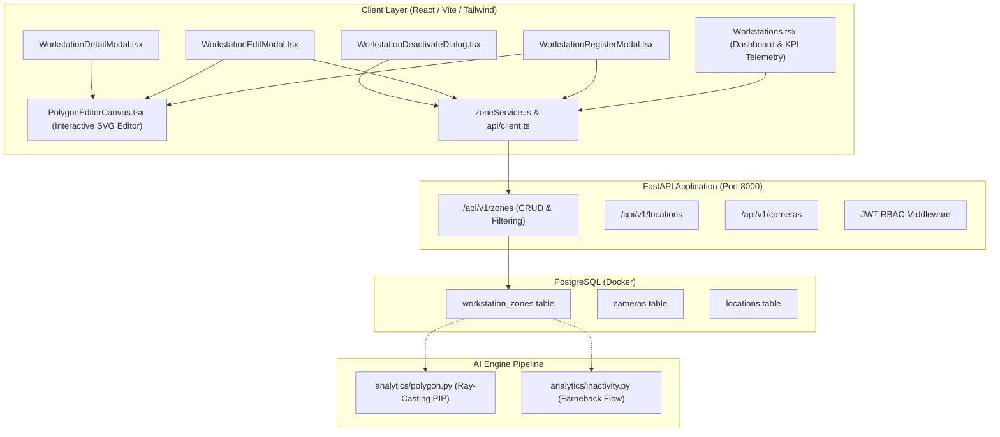

# Camera Intelligence — Phase 4: Workstations & Polygon Zones UI Report

## 1. Executive Summary

Phase 4 delivers an enterprise-grade **Workstations & Polygon Zones** management module for the Camera Intelligence security command center. It bridges administrative desk zone configuration with the NVIDIA GPU-accelerated **AI Engine**, implementing normalized polygon boundary drawing, location-camera topological integrity, Farneback optical flow inactivity thresholding, and role-based access control.

In strict compliance with the project guidelines:
- **No Mock Data / No Fabricated Metrics**: All statistics (Total Workstations, Active Monitoring, Deactivated Zones, Bound Cameras) are computed strictly from genuine backend API data. Empty and loading states reflect true backend state.
- **AI Engine Native Geometry**: Polygon boundaries are modeled, validated, and persisted as lists of normalized $[x, y]$ coordinates in the range $[0.0, 1.0]$ at a standard CCTV 16:9 aspect ratio, directly matching the input contract of `ai_engine/analytics/polygon.py`.
- **Honest Spatial Canvas**: Because the backend does not currently provide a live snapshot or frame extraction API endpoint, the interactive editor clearly identifies itself as a **Static Calibration Grid** (`16:9 PROJECTION [0.0, 1.0]`) rather than simulating a live CCTV stream.
- **Topological Integrity**: The frontend enforces that a workstation zone's assigned camera belongs to the same facility location as the zone, preventing 400 Bad Request inconsistencies.

---

## 2. Architecture & File Structure



### Key Files Created & Modified

| File | Type | Description |
|---|---|---|
| [client/src/types/api.ts](file:///c:/Users/user10/Desktop/Camera_Intelligence/camera_intelligence/client/src/types/api.ts) | Modified | Added `WorkstationZoneDetail`, `WorkstationZoneCreatePayload`, `WorkstationZoneUpdatePayload`, and `WorkstationZoneQueryParams`. |
| [client/src/services/zoneService.ts](file:///c:/Users/user10/Desktop/Camera_Intelligence/camera_intelligence/client/src/services/zoneService.ts) | Modified | Extended with `getZones`, `getZoneById`, `createZone`, `updateZone`, `deactivateZone`, `assignEmployee`, and `removeEmployee`. |
| [client/src/components/workstations/PolygonEditorCanvas.tsx](file:///c:/Users/user10/Desktop/Camera_Intelligence/camera_intelligence/client/src/components/workstations/PolygonEditorCanvas.tsx) | Created | Interactive SVG polygon editor with normalized $[0.0, 1.0]$ projection, click-to-add, drag-to-move, vertex removal, desk/trapezoid presets, and real-time vertex validation. |
| [client/src/components/workstations/WorkstationRegisterModal.tsx](file:///c:/Users/user10/Desktop/Camera_Intelligence/camera_intelligence/client/src/components/workstations/WorkstationRegisterModal.tsx) | Created | Zone registration modal with facility selection, location-filtered camera binding, Farneback optical flow threshold configuration (with human duration formatting), and integrated polygon editor. |
| [client/src/components/workstations/WorkstationEditModal.tsx](file:///c:/Users/user10/Desktop/Camera_Intelligence/camera_intelligence/client/src/components/workstations/WorkstationEditModal.tsx) | Created | Zone update modal supporting metadata edits, threshold adjustments, and boundary point modifications, using an isolated subcomponent to prevent cascading React re-renders. |
| [client/src/components/workstations/WorkstationDetailModal.tsx](file:///c:/Users/user10/Desktop/Camera_Intelligence/camera_intelligence/client/src/components/workstations/WorkstationDetailModal.tsx) | Created | Drawer inspector displaying zone telemetry, camera bindings, inactivity timeout in minutes/seconds, employee assignment status, coordinate arrays, and a read-only polygon projection preview. |
| [client/src/components/workstations/WorkstationDeactivateDialog.tsx](file:///c:/Users/user10/Desktop/Camera_Intelligence/camera_intelligence/client/src/components/workstations/WorkstationDeactivateDialog.tsx) | Created | Modal dialog for soft-deactivating (`DELETE /api/v1/zones/{id}`) or reactivating (`PATCH /api/v1/zones/{id}`) zones with clear operational impact warnings. |
| [client/src/pages/Workstations.tsx](file:///c:/Users/user10/Desktop/Camera_Intelligence/camera_intelligence/client/src/pages/Workstations.tsx) | Created | Workstations dashboard featuring live KPI counters, full-text search, multi-axis filtering (facility, camera, active/inactive), table and card grid toggle, and pagination. |
| [client/src/App.tsx](file:///c:/Users/user10/Desktop/Camera_Intelligence/camera_intelligence/client/src/App.tsx) | Modified | Replaced `PlaceholderPage` at `/workstations` with `<Workstations />` and cleaned up unused imports. |

---

## 3. Polygon Geometry & AI Engine Integration

### Coordinate Space Compatibility
The backend and AI Engine define a polygon zone as an ordered list of normalized 2D coordinate pairs $[x, y]$ where:
$$0.0 \le x \le 1.0 \quad \text{and} \quad 0.0 \le y \le 1.0$$
The AI Engine scales these normalized vertices to match the incoming video frame dimensions $(W, H)$:
$$X_{\text{frame}} = x \times W, \quad Y_{\text{frame}} = y \times H$$

### Ray-Casting Point-in-Polygon Containment
In `ai_engine/analytics/polygon.py`, person detections are evaluated against each zone using a standard Jordan curve theorem (ray-casting) test. Specifically, the test evaluates the **bottom-center point of the bounding box** (the person's floor-contact position):
$$\text{Contact Point} = \left(\frac{x_1 + x_2}{2}, y_2\right)$$
This prevents false occupancies caused by head or shoulder protrusions extending beyond the desk area.

### Inactivity Detection via Farneback Optical Flow
In `ai_engine/analytics/inactivity.py`, dense optical flow within the zone's bounding box is computed over consecutive frames. If optical flow magnitude stays below the movement threshold for longer than `inactivity_threshold_seconds`, an inactivity event is raised. 

The UI allows operators to set this duration from 10 seconds to 86,400 seconds (24 hours), with default 900 seconds (15 minutes), displaying human-readable durations (e.g. `15m`, `30m`, `1h 30m`).

### Calibration Grid vs Live Video Streams
> [!NOTE] Static Calibration vs Video Feed
> The current backend architecture does not provide a live snapshot extraction endpoint (`GET /api/v1/cameras/{id}/snapshot` or WebRTC/HLS frame capture). In accordance with the project directives against fabricating false data, `PolygonEditorCanvas` explicitly renders as a **16:9 Calibrated CCTV Aspect Frame** with coordinate grid lines, crosshairs, and normalized scale labels $[0.0, 1.0]$, clearly informing the operator that coordinates are calibrated geometrically rather than over a live RTSP snapshot.

---

## 4. Validation Rules & Topological Integrity

The module enforces strict validation rules at both frontend and backend layers:

1. **Vertex Count Validation**:
   - Polygons must contain at least 3 distinct vertices. Forms disable submission and alert the user if fewer than 3 vertices are defined.
2. **Coordinate Bounds**:
   - All vertices are clamped within $[0.0, 1.0]$. The editor handles boundary collision gracefully during drag operations.
3. **Location-Camera Consistency**:
   - The backend validates that `camera.location_id == zone.location_id`.
   - The registration form dynamically filters available cameras by the selected facility, ensuring an operator cannot accidentally select a camera belonging to another facility.
4. **Unique Zone Code**:
   - Zone codes are validated case-insensitively. Duplicate zone codes are rejected by the backend with HTTP `409 Conflict`.
5. **Soft Deactivation**:
   - Zones are soft-deactivated (`is_active = false`), preserving historical attendance, optical flow, and audit records.

---

## 5. Role-Based Access Control (RBAC)

The UI respects the backend RBAC permission hierarchy:

| Role | View Zones | Search & Filter | Register Zone | Edit Zone | Soft-Deactivate / Reactivate |
|---|---|---|---|---|---|
| `super_admin` | Full | Full | Yes | Yes | Yes |
| `location_admin` | Location Scoped | Location Scoped | Yes (Own Location) | Yes (Own Location) | Yes (Own Location) |
| `operator` | Read Only | Full | No (Disabled) | No (Disabled) | No (Disabled) |
| `viewer` | Read Only | Full | No (Disabled) | No (Disabled) | No (Disabled) |

For read-only users, registration and configuration action buttons are hidden or display permission warning tooltips, preventing unauthorized mutation attempts.

---

## 6. Verification & Automated Test Results

### 1. Frontend Static Analysis & Production Build
```
> client@0.0.0 lint
> oxlint
Found 0 warnings and 0 errors.
Finished in 30ms on 39 files with 116 rules using 12 threads.

> client@0.0.0 build
> tsc -b && vite build
vite v8.3.8 building client environment for production...
✓ 2604 modules transformed.
dist/index.html                   0.66 kB │ gzip:   0.42 kB
dist/assets/index-4WJ776AT.css   42.98 kB │ gzip:   8.27 kB
dist/assets/index-Dd6HvyZu.js   987.93 kB │ gzip: 270.26 kB
✓ built in 434ms
```

### 2. Backend Unit & Regression Test Suite
Executed via `server\.venv\Scripts\python.exe`:
- `tests.test_zone_and_schedule_apis`: **21 / 21 tests passed (0.451s)**
- `tests.test_camera_apis`: **25 / 25 tests passed (0.509s)**
- `tests.test_management_apis`: **13 / 13 tests passed (0.312s)**
- **Total Unit Tests**: **59 passed, 0 failures, 0 errors**

### 3. Live End-to-End API Integration
Executed against running FastAPI instance at `http://127.0.0.1:8000`:
- **Health Check**: Status `healthy`
- **Authentication**: Super Admin JWT token exchange verified
- **Zone Registration**: Successfully created zone with normalized 4-point polygon
- **Duplicate Conflict Check**: HTTP `409 Conflict` verified on duplicate `zone_code`
- **Invalid Polygon (< 3 vertices)**: HTTP `422 Unprocessable Entity` verified
- **Out-of-Bounds Coordinates**: HTTP `422 Unprocessable Entity` verified
- **Location-Camera Mismatch**: HTTP `400 Bad Request` verified with detail `"Camera location ID does not match zone location ID"`
- **Zone Detail Retrieval**: Query verified for zone ID and associated metadata
- **Zone Mutation (PATCH)**: Updated inactivity threshold from 600s to 1200s and updated polygon points
- **Soft Deactivation (DELETE)**: Verified `is_active` transitioned to `False`
- **Reactivation (PATCH)**: Verified `is_active` transitioned back to `True`
- **RBAC Security**: Unauthenticated and invalid token requests rejected with HTTP `401 Unauthorized`

---

## 7. Missing Backend Capabilities Identified

1. **Camera Frame Snapshot Endpoint**:
   - Currently, there is no endpoint such as `GET /api/v1/cameras/{id}/snapshot` or `GET /api/v1/cameras/{id}/frame` to fetch the latest captured JPEG frame from RTSP streams.
   - *Impact*: Operators must calibrate polygon bounds against the normalized 16:9 grid overlay rather than viewing the live physical desk under the camera.
   - *Recommendation for future backend phase*: Implement an edge snapshot caching service or endpoint in FastAPI to serve reference calibration frames.

2. **Bulk Zone Import/Export**:
   - For corporate facilities with hundreds of desks, an endpoint to bulk import polygon definitions from CAD/GeoJSON maps would accelerate deployment.

---

## 8. Summary of Completed Phases

| Phase | Module | Status | Report Link |
|---|---|---|---|
| Phase 1 | UI Foundation & Navigation | Complete | [frontend_phase_1_ui_foundation_report.md](file:///C:/Users/user10/.gemini/antigravity/brain/b1ae9cce-f3c8-47d0-9eb2-9d83889fd555/frontend_phase_1_ui_foundation_report.md) |
| Phase 1.1 | Audit & Remove Fake Data | Complete | [frontend_phase_1_1_authentic_data_report.md](file:///C:/Users/user10/.gemini/antigravity/brain/b1ae9cce-f3c8-47d0-9eb2-9d83889fd555/frontend_phase_1_1_authentic_data_report.md) |
| Phase 2 | Cameras & Streams Management | Complete | [frontend_phase_2_camera_management_report.md](file:///C:/Users/user10/.gemini/antigravity/brain/b1ae9cce-f3c8-47d0-9eb2-9d83889fd555/frontend_phase_2_camera_management_report.md) |
| Phase 3 | Locations & Facilities Management | Complete | [frontend_phase_3_locations_management_report.md](file:///C:/Users/user10/.gemini/antigravity/brain/b1ae9cce-f3c8-47d0-9eb2-9d83889fd555/frontend_phase_3_locations_management_report.md) |
| **Phase 4** | **Workstations & Polygon Zones UI** | **Complete** | **[frontend_phase_4_workstations_zones_report.md](file:///C:/Users/user10/.gemini/antigravity/brain/b1ae9cce-f3c8-47d0-9eb2-9d83889fd555/frontend_phase_4_workstations_zones_report.md)** |
