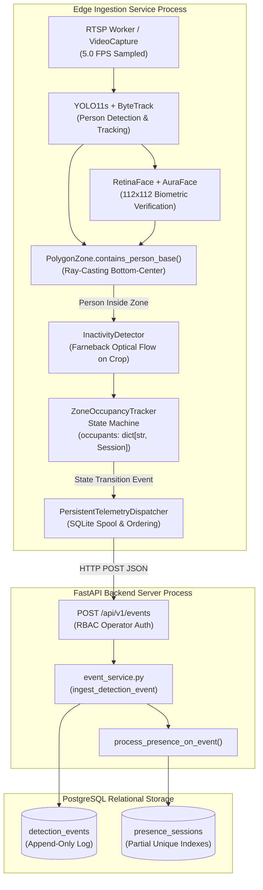

# Multi-Employee Occupancy Tracking, Inactivity Detection & Workstation PresenceSession Lifecycle Audit

**Project:** Camera Intelligence  
**Scope:** AI Engine Analytics, Edge Ingestion Pipeline, FastAPI Ingestion Services, and PostgreSQL Session Lifecycle  
**Audit Date:** November 2026  
**Status:** Complete Audit & Verification  

---

## 1. Executive Summary

This technical audit provides an exhaustive evaluation of the multi-employee occupancy tracking, dense optical flow inactivity detection, and backend workstation `PresenceSession` lifecycle in the **Camera Intelligence** platform. 

The audit inspected the end-to-end telemetry pathway—from frame ingestion in OpenCV/RTSP workers, through YOLO11s person tracking, RetinaFace/AuraFace biometrics, normalized polygon containment, and Farneback optical flow energy detection, to the FastAPI REST ingestion layer and PostgreSQL database models (`PresenceSession`, `DetectionEvent`).

### Key Findings
1. **Multi-Occupant Memory Architecture Works in Principle:** The AI Engine's `ZoneOccupancyTracker` maintains an internal dictionary `occupants: dict[str, ZoneOccupancySession]` that allows multiple individuals in the same physical workstation polygon to have independent tracking states, motion accumulators, and exit timers.
2. **Strict Transition-Driven Event Generation:** Events (`workstation_active`, `workstation_idle`) fire only on state changes (`VACANT -> ACTIVE`, `ACTIVE -> IDLE`, `IDLE -> ACTIVE`, and departure `-> VACANT`), preventing event spamming.
3. **Four High-Risk Architectural Defects Identified:**
   - **Defect 1 (Camera Disconnection Freezes Sessions):** When a camera stream drops, no new frames arrive. `MultiZoneManager.reset_camera()` is never invoked by stream manager or service handlers. In-memory sessions stay frozen in `ACTIVE` state, occlusion timers never evaluate, no departure event is emitted, and backend sessions remain open indefinitely.
   - **Defect 2 (Late Face Recognition Drops Session Creation):** If an employee enters a zone and is initially unverified (e.g. looking away), an initial event is emitted with `employee_id = None`. The backend ignores this for presence tracking. When the employee turns toward the camera 2 seconds later and is verified, the tracker updates `sess.employee_id = emp_id` and re-keys the session, but because `sess.occupancy_state` is already `ACTIVE`, no transition event is emitted. As a result, **no `PresenceSession` is ever opened in PostgreSQL for the entire occupancy duration**.
   - **Defect 3 (Inactivity Metrics Never Accumulated in Backend):** The `PresenceSession` model defines `active_seconds` and `idle_seconds` columns with database check constraints (`>= 0`). However, backend `event_service.py` never computes or updates these columns on subsequent events. Upon closure, both metrics remain 0.
   - **Defect 4 (No Heartbeat / Orphan Session Reconciliation Worker):** The backend has no background scheduler or camera offline listener to reconcile open presence sessions. If the Edge service crashes or camera network disconnects, all active sessions remain orphaned with `ended_at = NULL`.

---

## 2. Files Inspected

| Component | File Path | Primary Responsibilities Inspected |
| :--- | :--- | :--- |
| **Polygon Containment** | [`ai_engine/analytics/polygon.py`](file:///c:/Users/user10/Desktop/Camera_Intelligence/camera_intelligence/ai_engine/analytics/polygon.py) | Ray-casting point-in-polygon algorithm, normalized [0, 1] vertex space, person base contact point calculation `((x1+x2)/2, y2)`. |
| **Inactivity Detector** | [`ai_engine/analytics/inactivity_detector.py`](file:///c:/Users/user10/Desktop/Camera_Intelligence/camera_intelligence/ai_engine/analytics/inactivity_detector.py) | Farneback dense optical flow, temporal frame differencing, standardized 128×128 ROI, luminance shift compensation. |
| **Occupancy Tracker** | [`ai_engine/analytics/occupancy_tracker.py`](file:///c:/Users/user10/Desktop/Camera_Intelligence/camera_intelligence/ai_engine/analytics/occupancy_tracker.py) | `ZoneOccupancyTracker`, `ZoneOccupancySession`, `MultiZoneManager`, multi-occupant dict, state machine transitions, occlusion timer. |
| **Pipeline Worker** | [`ai_engine/pipeline/pipeline_worker.py`](file:///c:/Users/user10/Desktop/Camera_Intelligence/camera_intelligence/ai_engine/pipeline/pipeline_worker.py) | YOLO11s detection + ByteTrack tracking, person crop extraction, face pipeline integration, zone event emission. |
| **Stream Tracking** | [`ai_engine/pipeline/tracker.py`](file:///c:/Users/user10/Desktop/Camera_Intelligence/camera_intelligence/ai_engine/pipeline/tracker.py) | `StreamTrackerManager`, ephemeral stream tracking identifiers `cam{id}_trk_{id}`, identity leak isolation. |
| **AI Configuration** | [`ai_engine/config.py`](file:///c:/Users/user10/Desktop/Camera_Intelligence/camera_intelligence/ai_engine/config.py) | Validated thresholds: occlusion tolerance (5.0s), inactivity timeout (900.0s), optical flow magnitude (0.8 px), diff intensity (2.5). |
| **Edge Service** | [`ai_engine/service.py`](file:///c:/Users/user10/Desktop/Camera_Intelligence/camera_intelligence/ai_engine/service.py) | Lifecycle management, camera sync, stream manager dispatching, shutdown sequence. |
| **Presence Model** | [`server/app/models/presence_session.py`](file:///c:/Users/user10/Desktop/Camera_Intelligence/camera_intelligence/server/app/models/presence_session.py) | `PresenceSession` SQLAlchemy model, partial unique indexes (`uq_open_workstation_session_per_employee`), check constraints. |
| **Event Model** | [`server/app/models/detection_event.py`](file:///c:/Users/user10/Desktop/Camera_Intelligence/camera_intelligence/server/app/models/detection_event.py) | `DetectionEvent` append-only audit log, event types, foreign keys, query indexes. |
| **Event Ingestion Service**| [`server/app/services/event_service.py`](file:///c:/Users/user10/Desktop/Camera_Intelligence/camera_intelligence/server/app/services/event_service.py) | `ingest_detection_event`, `process_presence_on_event`, session creation/closure logic, location consistency checks. |
| **Event API Endpoint** | [`server/app/api/v1/endpoints/events.py`](file:///c:/Users/user10/Desktop/Camera_Intelligence/camera_intelligence/server/app/api/v1/endpoints/events.py) | `POST /api/v1/events` ingestion route, RBAC operator dependency, validation error handling. |

---

## 3. End-to-End Architecture & Telemetry Data Flow



### Telemetry Contract Details
When state transitions or departures occur, the AI Engine dispatches a payload conforming to `DetectionPayload`:
- **Entry Event:** `event_type = "workstation_active"`, `metadata_json: {"previous_state": "vacant", "current_state": "active", "motion_score": ...}`.
- **Inactivity Event:** `event_type = "workstation_idle"`, `metadata_json: {"previous_state": "active", "current_state": "idle", "inactivity_duration_seconds": ...}`.
- **Resume Motion Event:** `event_type = "workstation_active"`, `metadata_json: {"previous_state": "idle", "current_state": "active", "resume_motion_score": ...}`.
- **Departure Event:** `event_type = "workstation_idle"`, `metadata_json: {"previous_state": "active|idle", "current_state": "vacant", "action": "exit", "is_departure": True, "total_duration_seconds": ...}`.

---

## 4. Verified Existing Behavior: AI Engine Analytics

### 1. Can multiple employees occupy the same workstation zone simultaneously?
**Yes.**  
In [`ai_engine/analytics/occupancy_tracker.py`](file:///c:/Users/user10/Desktop/Camera_Intelligence/camera_intelligence/ai_engine/analytics/occupancy_tracker.py#L77), `ZoneOccupancyTracker` stores occupants in an internal dictionary:
```python
self.occupants: dict[str, ZoneOccupancySession] = {}
```
Each occupant is keyed by `emp_{employee_id}` (if verified by face) or ephemeral `cam{cam_id}_trk_{tracker_id}` (if unverified). Each occupant possesses their own `ZoneOccupancySession` instance containing independent state variables (`occupancy_state`, `entry_time`, `last_seen_time`, `consecutive_missing_frames`, and `InactivityDetector`).

*Caveat:* The backward compatibility property `tracker.session` ([lines 84–96](file:///c:/Users/user10/Desktop/Camera_Intelligence/camera_intelligence/ai_engine/analytics/occupancy_tracker.py#L84-L96)) returns only the primary active occupant session. Any code relying on `.session` instead of `.occupants` will see only a single occupant.

### 2. Is occupancy maintained independently for each tracking ID?
**Yes.**  
Every person detected inside the zone polygon is iterated over individually in `tracker.update()` ([lines 127–297](file:///c:/Users/user10/Desktop/Camera_Intelligence/camera_intelligence/ai_engine/analytics/occupancy_tracker.py#L127-L297)). The person's crop is extracted and passed to their dedicated `InactivityDetector`. Optical flow metrics, elapsed idle time, and state transitions are computed on a per-occupant basis.

### 3. Can one employee becoming idle affect another employee's state?
**No.**  
Each `ZoneOccupancySession` has its own isolated `InactivityDetector`. Optical flow is evaluated strictly on the bounding-box crop of each individual occupant ([line 188](file:///c:/Users/user10/Desktop/Camera_Intelligence/camera_intelligence/ai_engine/analytics/occupancy_tracker.py#L188): `crop = person.extract_crop(frame_bgr)`).  
When Occupant A remains static for `> inactivity_threshold_seconds`, their session transitions to `IDLE` and emits `workstation_idle`. Occupant B, who continues typing or moving, keeps resetting their own `InactivityDetector`, remaining `ACTIVE` without interruption. (Verified in Unit Test `test_18_multi_occupant_one_idle_one_active`).

*Physical limitation:* If two occupants heavily overlap in the 2D camera view, the crop of Occupant A may capture pixel motion from Occupant B, potentially delaying Occupant A's transition to idle.

### 4. How are temporary occlusions handled?
**Through the `occlusion_tolerance_seconds` grace window.**  
In [`occupancy_tracker.py`](file:///c:/Users/user10/Desktop/Camera_Intelligence/camera_intelligence/ai_engine/analytics/occupancy_tracker.py#L299-L348), at the end of each frame update, any occupant not present in `seen_keys` is evaluated:
```python
sess.consecutive_missing_frames += 1
time_missing = now - sess.last_seen_time
if time_missing >= self.occlusion_tolerance_seconds:
    # transition to VACANT and emit departure
```
By default, `DEFAULT_OCCLUSION_TOLERANCE_SECONDS = 5.0` seconds ([`ai_engine/config.py:67`](file:///c:/Users/user10/Desktop/Camera_Intelligence/camera_intelligence/ai_engine/config.py#L67)). If an occupant is occluded by someone walking in front of them or if detection drops for under 5.0 seconds, the session state is preserved. Once the person reappears within 5.0s, `sess.consecutive_missing_frames` resets to 0 and tracking continues without firing duplicate entry events.

### 5. How are tracking ID changes and lost tracks handled?
- **Recognized Employees:** If a person's ByteTrack tracking ID changes (e.g. track lost and reacquired) but face recognition recognizes the employee, the key resolves to `emp_{employee_id}` ([lines 137–146](file:///c:/Users/user10/Desktop/Camera_Intelligence/camera_intelligence/ai_engine/analytics/occupancy_tracker.py#L137-L146)). The tracker re-associates the new ephemeral tracker ID with the existing employee session.
- **Unrecognized Persons:** If an unverified person loses their tracking ID, a new session is created under `cam{id}_trk_{new_id}`. The old tracking session expires after 5.0s of occlusion tolerance, emitting a departure event.

### 6. How are camera disconnections handled?
**CRITICAL DEFECT DETECTED.**  
`MultiZoneManager` provides a method `reset_camera(camera_id, emit_exit_events)` ([line 468](file:///c:/Users/user10/Desktop/Camera_Intelligence/camera_intelligence/ai_engine/analytics/occupancy_tracker.py#L468)). However:
1. `reset_camera` is **never invoked** anywhere in `ai_engine/service.py` or `ai_engine/stream/stream_manager.py`.
2. When an RTSP stream disconnects, `stream_manager.get_any_frame()` ceases to deliver frames for that camera.
3. Because no frames arrive, `LivePipelineWorker.process_frame()` is not called for that camera.
4. Because `process_frame()` is not called, `tracker.update()` is not called.
5. Because `tracker.update()` is not called, the occlusion timer (`time_missing >= 5.0s`) is **never evaluated**.
6. **Result:** In-memory occupancy states remain frozen in `ACTIVE` or `IDLE`. No departure event is ever generated or sent to the backend.

### 7. Are state transitions emitted only when necessary?
**Yes.**  
State transitions are strictly edge-triggered:
- `VACANT -> ACTIVE`: Fired once on entry.
- `ACTIVE -> IDLE`: Fired once when `idle_seconds >= inactivity_threshold_seconds`.
- `IDLE -> ACTIVE`: Fired once when `is_active` motion resumes.
- `ACTIVE|IDLE -> VACANT`: Fired once upon departure when `time_missing >= occlusion_tolerance_seconds`.  
Subsequent frames while the occupant remains in `ACTIVE` or `IDLE` generate **zero** events.

### 8. Can an employee moving between zones create incorrect occupancy?
**Briefly (during the 5.0s occlusion window), but prevented in backend.**  
When an employee walks from Zone A to Zone B:
1. At $t = 0$: Employee enters Zone B. Zone B immediately emits `workstation_active`.
2. For $0 \le t < 5.0s$: The employee is missing from Zone A. However, Zone A waits for `occlusion_tolerance_seconds` (5.0s). In the AI Engine's memory, Zone A still holds the occupant as `ACTIVE` until $t = 5.0s$.
3. At $t = 5.0s$: Zone A's occlusion timer expires, marking Zone A `VACANT` and emitting a departure event.
4. *Backend reconciliation:* In the backend, when Zone B's `workstation_active` event arrives at $t = 0$, the backend explicitly closes any prior open workstation sessions for that employee across other zones ([`event_service.py:111-122`](file:///c:/Users/user10/Desktop/Camera_Intelligence/camera_intelligence/server/app/services/event_service.py#L111-L122)). When Zone A's departure arrives 5.0s later, it is safely ignored.

---

## 5. Verified Existing Behavior: Backend Session Lifecycle

### 1. How is a session created when an employee enters a workstation?
In [`server/app/services/event_service.py:109-140`](file:///c:/Users/user10/Desktop/Camera_Intelligence/camera_intelligence/server/app/services/event_service.py#L109-L140):
1. Condition: `event.workstation_zone_id is not None`, `event.event_type == "workstation_active"`, and `event.employee_id is not None`.
2. The service checks for an existing open session:
   ```python
   ws_session = db.query(PresenceSession).filter(
       PresenceSession.employee_id == event.employee_id,
       PresenceSession.workstation_zone_id == event.workstation_zone_id,
       PresenceSession.session_type == "workstation",
       PresenceSession.ended_at.is_(None),
   ).first()
   ```
3. If `ws_session is None`:
   - Closes any open workstation sessions for this employee in other zones (`ended_at = event.occurred_at`, `status = "closed"`).
   - Instantiates a new `PresenceSession` with `session_type = "workstation"`, `status = "active"`, `started_at = event.occurred_at`, `last_seen_at = event.occurred_at`, `active_seconds = 0`, `idle_seconds = 0`.
   - Flushes to DB and sets `event.presence_session_id = new_ws.id`.
4. *Unknown persons:* If `event.employee_id is None`, `process_presence_on_event` immediately returns `None` ([line 37](file:///c:/Users/user10/Desktop/Camera_Intelligence/camera_intelligence/server/app/services/event_service.py#L37)). No session is created.

### 2. How is a session updated during continued occupancy?
In [`event_service.py:141-146`](file:///c:/Users/user10/Desktop/Camera_Intelligence/camera_intelligence/server/app/services/event_service.py#L141-L146):
- When a transition event (`workstation_idle` or resume `workstation_active`) arrives for an existing open session:
  - If `event.occurred_at > ws_session.last_seen_at`: updates `ws_session.last_seen_at = event.occurred_at`.
  - Updates `ws_session.status = "active"` if `workstation_active` else `"idle"`.
- **DEFECT:** `ws_session.active_seconds` and `ws_session.idle_seconds` are **never updated**.

### 3. How is a session closed when an employee leaves?
In [`event_service.py:99-107`](file:///c:/Users/user10/Desktop/Camera_Intelligence/camera_intelligence/server/app/services/event_service.py#L99-L107):
- Departure contract: The event must have `event_type == "workstation_idle"` and metadata containing `action == "exit"`, `current_state == "vacant"`, or `is_departure == True`.
- If an open `PresenceSession` is found:
  - `ws_session.ended_at = event.occurred_at`
  - `ws_session.status = "closed"`
  - `ws_session.last_seen_at = max(ws_session.last_seen_at, event.occurred_at)`
  - Links `event.presence_session_id = ws_session.id`.

### 4. How is a session closed when an employee moves to another zone?
When Employee enters Zone B:
1. Zone B emits `workstation_active`.
2. Backend searches for all open workstation sessions for `employee_id` ([lines 111–122](file:///c:/Users/user10/Desktop/Camera_Intelligence/camera_intelligence/server/app/services/event_service.py#L111-L122)):
   ```python
   prior_open = db.query(PresenceSession).filter(
       PresenceSession.employee_id == event.employee_id,
       PresenceSession.session_type == "workstation",
       PresenceSession.ended_at.is_(None),
   ).all()
   for prior in prior_open:
       prior.ended_at = event.occurred_at
       prior.status = "closed"
   ```
3. Prior Zone A is immediately marked closed with `ended_at = event.occurred_at`.
4. When Zone A emits its departure event 5s later, `ws_session` is `None` (already closed), so it returns `None` safely.

### 5. How is a session closed if a camera disconnects?
**It is NOT closed (CRITICAL DEFECT).**  
Because the Edge service never emits departure events on camera loss and the backend has no offline session reaper or camera timeout monitor, any open `PresenceSession` remains in `status = 'active'`, `ended_at = NULL` permanently in PostgreSQL.

### 6. How are duplicate occupancy events handled?
- **Duplicate `workstation_active`:** If an active event arrives for an already open session, line 142 checks `if event.occurred_at > ws_session.last_seen_at:` and updates `last_seen_at`. No duplicate session is created.
- **Duplicate Departure:** If a departure arrives for an already closed session, line 100 sees `ws_session is None` and returns `None`. No error is thrown.
- **Partial Unique Index Guard:** The database enforces partial unique index `uq_open_workstation_session_per_employee` on `(employee_id, workstation_zone_id)` where `session_type = 'workstation' AND ended_at IS NULL`. Any race condition attempting to insert a second open session for the same zone raises an integrity error and rolls back the transaction.

### 7. How are out-of-order occupancy events handled?
- **Departure arrives before Entry:** If network delays cause a departure event to arrive before the initial active event, no open session exists. The departure is ignored. When the delayed active event subsequently arrives, it creates a new session that may stay open indefinitely.
- **Timestamp Regression:** If an event arrives with `event.occurred_at < ws_session.last_seen_at`, line 142 preserves `last_seen_at` without regression.

### 8. What happens to open sessions if Edge restarts?
1. On Edge restart, internal in-memory tracker state in Python is reset (`occupants = {}`).
2. When the camera comes online and occupants are re-detected, the AI Engine treats them as new entries and emits `workstation_active`.
3. The backend receives `workstation_active`. If an unclosed session already existed for that zone, it does not create a new one; it simply refreshes `last_seen_at` ([line 141](file:///c:/Users/user10/Desktop/Camera_Intelligence/camera_intelligence/server/app/services/event_service.py#L141)).
4. *Failure condition:* If an employee left during Edge downtime, the departure event is never emitted. The backend session remains open forever.

### 9. Can orphaned sessions occur? Under what conditions?
**Yes.** Orphaned sessions occur under four specific scenarios:
1. **Camera Disconnection / RTSP Failure:** Frame flow stops; occlusion timer never evaluates; no exit event dispatched.
2. **Edge Service Crash / Hard Kill:** Process terminates abruptly; queue and memory lost before exit events can be dispatched.
3. **Network Partition / Telemetry Buffer Overflow:** If the Edge service is offline longer than the persistent dispatcher's spool capacity or if exit events fail to retry.
4. **Late Face Recognition in Zone (Defect 2):** Employee enters unverified, verified later, but no transition event is emitted.

---

## 6. Comprehensive Defect & Risk Analysis

```mermaid
classDiagram
    class Defect1_CameraDisconnect {
        +Trigger: RTSP stream drops
        +Failure: reset_camera() not called
        +Impact: Occupancy frozen in memory, DB session never closes
        +Severity: CRITICAL
    }
    class Defect2_LateRecognition {
        +Trigger: Face recognized on frame N > 1
        +Failure: State is already ACTIVE, no transition event
        +Impact: Zero PresenceSession recorded in PostgreSQL
        +Severity: CRITICAL
    }
    class Defect3_ZeroDurations {
        +Trigger: Session updates during occupancy
        +Failure: active_seconds/idle_seconds never calculated
        +Impact: Analytics report 0 seconds for all closed sessions
        +Severity: HIGH
    }
    class Defect4_NoReaperWorker {
        +Trigger: Edge crash or prolonged network outage
        +Failure: No backend TTL / heartbeat reconciliation
        +Impact: Permanent orphaned presence sessions in DB
        +Severity: HIGH
    }
```



### Detailed Defect Descriptions

#### Defect 1: Disconnected Camera Stream Never Evaluates Departure
- **Root Cause:** In [`ai_engine/pipeline/pipeline_worker.py:169`](file:///c:/Users/user10/Desktop/Camera_Intelligence/camera_intelligence/ai_engine/pipeline/pipeline_worker.py#L169), `stream_manager.get_any_frame()` returns frames only for active cameras. When a camera disconnects, no frames arrive for that camera ID. Occlusion tracking inside `ZoneOccupancyTracker.update()` requires frames to be called to increment `consecutive_missing_frames` and compare `now - last_seen_time >= 5.0s`. Because `update()` is never called, the occlusion timer never triggers.
- **Fix Required:** The stream manager or camera health monitor must notify `MultiZoneManager.reset_camera(camera_id, emit_exit_events=True)` when a camera status transitions to `DISCONNECTED` or fails read timeouts.

#### Defect 2: Late Face Recognition Produces Missing Backend Sessions
- **Root Cause:** In [`ai_engine/analytics/occupancy_tracker.py:178-186`](file:///c:/Users/user10/Desktop/Camera_Intelligence/camera_intelligence/ai_engine/analytics/occupancy_tracker.py#L178-L186):
  ```python
  if not sess.is_employee_recognized and is_recognized:
      sess.employee_id = recognized_emp_id
      sess.is_employee_recognized = True
      # Re-keys occupant map
  ```
  Immediately following this, the state machine evaluates:
  ```python
  if prev_state == OccupancyState.VACANT: # FALSE! prev_state is already ACTIVE
  ```
  Because `prev_state` is already `ACTIVE`, no transition occurs. No event is generated. The backend, having ignored the initial entry event because `employee_id` was `None`, never receives a `workstation_active` event with the newly identified `employee_id`.
- **Fix Required:** When an active session transitions from unrecognized (`is_employee_recognized == False`) to recognized (`True`), an explicit transition or identification event must be emitted so the backend can create the `PresenceSession`.

#### Defect 3: `active_seconds` and `idle_seconds` Never Updated
- **Root Cause:** In [`server/app/services/event_service.py:141-146`](file:///c:/Users/user10/Desktop/Camera_Intelligence/camera_intelligence/server/app/services/event_service.py#L141-L146), when events update an existing `PresenceSession`, only `last_seen_at` and `status` are modified:
  ```python
  ws_session.last_seen_at = event.occurred_at
  ws_session.status = "active" if event.event_type == "workstation_active" else "idle"
  ```
  Neither `active_seconds` nor `idle_seconds` are accumulated or calculated upon session closure.
- **Fix Required:** On closure (and upon state transitions), the backend should calculate `elapsed = (event.occurred_at - ws_session.last_seen_at).total_seconds()` and increment the corresponding counter, or compute total active/idle time from metadata payloads.

#### Defect 4: Lack of Backend Stale Session Reconciliation Worker
- **Root Cause:** There is no periodic cron or celery/async task in the FastAPI backend that scans `presence_sessions` where `ended_at IS NULL` and `last_seen_at < NOW() - INTERVAL '30 minutes'`.
- **Fix Required:** Implement a backend background reconciliation task that automatically closes sessions whose associated camera has reported offline or whose `last_seen_at` exceeds a maximum grace period.

---

## 7. Existing Test Coverage & Verification Results

The existing test suites were executed against the actual codebases:

### 1. Workstation & Inactivity Test Suite (`tests/test_workstation_inactivity.py`)
- **Execution Command:** `ai_engine/.venv/Scripts/python.exe -m unittest discover -s tests -p "test_workstation_inactivity.py"`
- **Result:** **20 passed in 0.447s**
- **Existing Coverage Highlights:**
  - `test_01` – `test_05`: Ray-casting algorithm, convex/concave polygons, boundary points, normalized to pixel space, bottom-center base containment.
  - `test_06` – `test_09`: Inactivity optical flow motion, threshold transitions, motion resumption.
  - `test_10`: Occlusion tolerance window (5.0s).
  - `test_11` – `test_12`: Transition-driven event suppression, unknown person ID protection.
  - `test_16`: Multiple occupants in same zone with independent state machines.
  - `test_17`: Multi-occupant: one leaves, one remains (isolated departure).
  - `test_18`: Multi-occupant: one idle, one active (independent inactivity).
  - `test_19`: Lighting flicker and Gaussian sensor noise rejection.
  - `test_20`: Backend `process_presence_on_event` closure verification.

### 2. Stream Manager & Live Pipeline Suite (`tests/test_stream_manager_pipeline.py`)
- **Execution Command:** `ai_engine/.venv/Scripts/python.exe -m unittest discover -s tests -p "test_stream_manager_pipeline.py"`
- **Result:** **14 passed in 7.738s**
- **Existing Coverage Highlights:**
  - Bounded frame buffer queue FIFO drops and memory safety.
  - Multi-camera failure isolation (one camera failing does not disrupt others).
  - YOLO11s + ByteTrack integration and ephemeral tracker prefixing (`cam1_trk_X`).
  - Face processing pipeline and AuraFace 512D biometric extraction.

---

## 8. Missing Test Coverage & Test Gaps

While core spatial and optical flow mechanics are well-tested in isolation, significant integration and edge-case gaps exist:

1. **Late Face Recognition in Zone:** No test asserts what happens when a person enters unidentified and is identified 3 frames later.
2. **Camera Disconnection during Active Occupancy:** No test verifies session closure when a camera stream fails while occupants are seated.
3. **Simultaneous Multi-Occupant Occlusion Handover:** No test covers two persons crossing paths inside a zone where tracker IDs swap.
4. **Out-of-Order Departure / Entry Ingestion:** No test verifies backend behavior when network delays reorder HTTP event deliveries.
5. **Backend `active_seconds` / `idle_seconds` Accumulation:** No test verifies that duration metrics are populated upon session closure.
6. **Concurrent Duplicate Ingestion Race Conditions:** No multi-threaded test simulates two concurrent workers ingesting the same entry event to verify PostgreSQL unique index conflict handling.

---

## 9. Comprehensive 12-Scenario Validation Matrix

This test matrix defines the rigorous validation plan for Task 2 and future stabilization:

| # | Scenario | Preconditions | Input Trigger | Expected AI Engine Behavior | Expected Backend Session Behavior | Current Code Reality / Defect Risk | Verification Method |
| :---: | :--- | :--- | :--- | :--- | :--- | :--- | :--- |
| **1** | **Two Employees in One Zone** | Shared desk zone registered. | Emp 101 and Emp 102 enter zone simultaneously. | Emits 2 `workstation_active` events with respective `employee_id`s. `tracker.occupants` holds 2 active sessions. | Opens 2 distinct `PresenceSession` records with `status = "active"`. | **Works.** Verified by Unit Test 16. | Unit test + Live API integration test. |
| **2** | **Three Employees in One Zone** | Collaborative meeting zone registered. | Emp 1, Emp 2, Emp 3 enter zone. | Emits 3 separate `workstation_active` events. 3 independent `InactivityDetector`s created. | Opens 3 distinct `PresenceSession` records in PostgreSQL. | **Works.** Memory scales with occupants. | Unit test simulating 3 bounding boxes. |
| **3** | **One Active, One Idle in Same Zone** | Emp 101 and 102 actively seated. | Emp 102 stops moving for > threshold; Emp 101 keeps typing. | Emits `workstation_idle` only for Emp 102. Emp 101 remains `ACTIVE`. | Emp 102's session transitions to `status = "idle"`. Emp 101 stays `status = "active"`. | **Works.** Verified by Unit Test 18. | Synthetic optical flow test with localized pixel shifts. |
| **4** | **One Employee Leaves, One Remains** | Emp 201 and 202 actively seated. | Emp 201 exits zone; Emp 202 remains. | After 5.0s, emits departure event for Emp 201 (`action: "exit"`). Emp 202 untouched. | Emp 201's session closes (`ended_at` set). Emp 202 remains open. | **Works.** Verified by Unit Test 17. | Multi-frame simulation with disappearance. |
| **5** | **Temporary Face / Person Occlusion** | Emp 101 seated in zone. | Co-worker walks in front of Emp 101 for 3.0s (< 5.0s tolerance). | `time_missing < 5.0s`. No departure emitted. Session preserved. Re-detects at 3.1s without re-triggering entry. | No events dispatched. Backend session remains open without state oscillation. | **Works.** Verified by Unit Test 10. | Frame sequence with 3.0s blank/dropped detections. |
| **6** | **Employee Moving Between Zones** | Zone A and Zone B monitored on same or different cameras. | Emp 101 walks from Zone A to Zone B. | Zone B emits `workstation_active` at $t=0$. Zone A emits departure at $t=5.0s$. | Backend closes Zone A session at $t=0$ upon Zone B entry. Departure at $t=5.0s$ is safely ignored. | **Works.** (Transient double occupancy in AI memory for 5s). | Two-zone sequence test. |
| **7** | **Employee Disappearing from Camera View** | Emp 101 seated in zone. | Camera view suddenly obstructed or person abruptly steps out. | `consecutive_missing_frames` increments. At 5.0s, departure event emitted. | Backend session closed with `ended_at = last_seen_at`. | **Works.** | Video clip cut-off test. |
| **8** | **Camera Disconnection During Occupancy** | Emp 101 actively seated in Zone 1. | RTSP stream disconnects / network cable pulled. | Frame worker stops feeding frames. `reset_camera()` **must** be called to flush departure events. | **CRITICAL DEFECT.** Currently, AI Engine freezes state and backend session remains open forever. | Synthetic camera disconnect event injected into stream manager. |
| **9** | **Duplicate Departure Event** | PresenceSession for Emp 101 was already closed. | Network retry delivers duplicate departure event. | Event client retries delivery. | Backend sees no open session (`ws_session is None`) and gracefully returns `None` without error. | **Works.** Verified by inspection of `event_service.py:100`. | Duplicate HTTP POST test. |
| **10** | **Out-of-Order Occupancy Events** | Network latency delivers departure before entry. | Departure arrives at $t=1$; Entry arrives at $t=2$. | Telemetry dispatcher normally enforces FIFO, but network proxy may reorder. | Departure is dropped (no session found). Delayed entry creates orphaned session. | **DEFECT RISK.** Backend lacks sequence vector / version check. | Synthetic reverse HTTP injection test. |
| **11** | **Edge Service Restart With Active Occupants** | Emp 101 was seated when Edge service crashed/restarted. | Edge service boots up; camera comes online; Emp 101 detected. | Edge emits new `workstation_active` event. | Backend sees existing open session for Emp 101 and refreshes `last_seen_at` without duplicate insert. | **Works.** | Edge process restart simulation test. |
| **12** | **Backend Session Reconciliation for Offline Cameras** | Camera offline for > 10 minutes. | Periodic backend reaper job executes. | AI Engine is offline or disconnected. | Backend scans open sessions whose cameras are offline and closes them with `ended_at = last_seen_at`. | **CRITICAL DEFECT.** No such reaper job currently exists in backend. | Backend scheduled task verification. |

---

## 10. Prioritized Recommendations for Next Implementation Phase

### High Priority (Critical Stability Fixes)
1. **Wire Camera Disconnection to MultiZoneManager:**
   - In `ai_engine/service.py` and `stream_manager.py`, register a callback on worker state change. When a camera transitions to `DISCONNECTED` or fails repeatedly, trigger `zone_manager.reset_camera(camera_id, emit_exit_events=True)` to dispatch graceful departure events.
2. **Fix Late Face Recognition Event Emission:**
   - In `ZoneOccupancyTracker.update()`, detect when `sess.is_employee_recognized` transitions from `False` to `True` while `sess.occupancy_state == OccupancyState.ACTIVE`. Emit a synthetic `workstation_active` event with the newly resolved `employee_id` so the backend can create the `PresenceSession`.
3. **Accumulate `active_seconds` and `idle_seconds` in Backend:**
   - In `server/app/services/event_service.py`, update `active_seconds` and `idle_seconds` on state changes and session closure so historical session data reflects real metrics rather than 0.

### Medium Priority (Resilience & Hardening)
4. **Implement Backend Stale Session Reaper:**
   - Add a lightweight scheduled job in FastAPI / Celery / BackgroundTasks that inspects `PresenceSession` records where `ended_at IS NULL` and `last_seen_at < NOW() - INTERVAL '15 minutes'`. If the associated camera is offline or heartbeat is missing, auto-close the session with `status = 'closed'` and `ended_at = last_seen_at`.
5. **Add Multi-Occupant Automated Integration Tests:**
   - Create a dedicated integration suite `tests/test_multi_employee_occupancy_lifecycle.py` executing all 12 scenarios from the validation matrix against a live test database.
