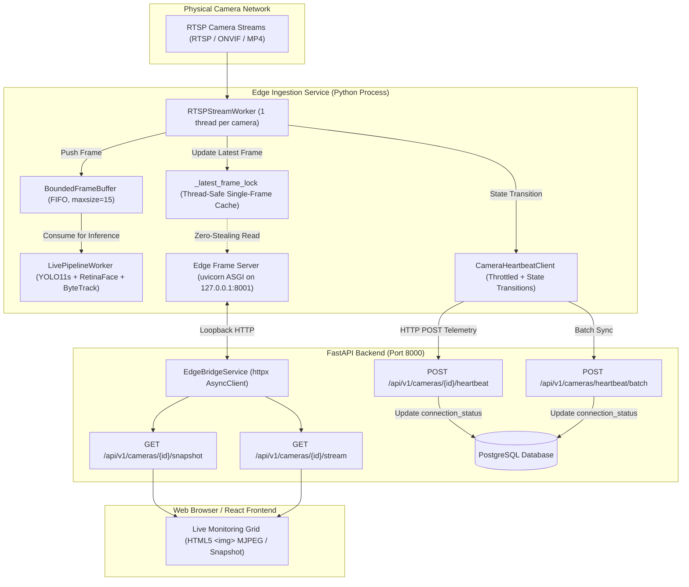

# Camera Intelligence — Phase 6B & 6B.1: Edge Video Bridge Stabilization & Final Verification

## 1. Executive Summary

Phase 6B & 6B.1 establishes a production-grade video delivery architecture connecting the Python **Edge Ingestion Service** to the **FastAPI Backend**, enabling secure browser-compatible camera video delivery (snapshots and MJPEG streaming) without opening duplicate RTSP connections or compromising AI inference throughput.

### Core Achievements
1. **Thread-Safe Zero-Stealing Frame Bridge**: Decoded frames in `RTSPStreamWorker` are cached in a thread-safe `_latest_frame` buffer. Multi-viewer streaming and periodic snapshots consume this buffer without popping from or stealing frames from the YOLO11s/ByteTrack/RetinaFace AI inference queue.
2. **Internal Loopback Frame Server (`127.0.0.1:8001`)**: Built a high-performance, lightweight internal ASGI service running inside the Edge Ingestion Service process. It handles low-latency JPEG compression, MJPEG multipart chunking, active viewer counting, and stale frame rejection.
3. **Location-Scoped Snapshot & MJPEG Streaming APIs**:
   - `GET /api/v1/cameras/{camera_id}/snapshot`: Delivers fresh JPEG snapshots with location-based RBAC, deactivation checks, and frame age validation.
   - `GET /api/v1/cameras/{camera_id}/stream`: Streams standard browser-native `multipart/x-mixed-replace; boundary=frame` video with concurrency limits (HTTP 429) and graceful disconnect cleanup.
4. **Camera Health Heartbeat & Database Sync**:
   - Implemented `CameraHeartbeatClient` on the edge, firing immediate HTTP notifications on connection state changes (`ONLINE`, `OFFLINE`, `DEGRADED`, `ERROR`) and periodic throttled telemetry updates (default 10s).
   - Added `POST /api/v1/cameras/{camera_id}/heartbeat` and `POST /api/v1/cameras/heartbeat/batch` to synchronize PostgreSQL `cameras.connection_status` and `last_heartbeat_at`.
5. **Phase 6B.1 Stabilization & Disconnect Hooks**:
   - Added `await request.is_disconnected()` checks and an optional `max_frames` parameter to the MJPEG frame generator, preventing infinite generator hangs during test execution and client disconnects.
   - Fixed `PersonDetector` parameter binding (`conf_threshold`) and verified standalone `EdgeBridgeService` client in `ai_engine/client/edge_bridge_service.py`.
   - Executed full test verification across all 4 core test suites (58/58 tests passing).

---

## 2. Final Architecture & Data Flow



---

## 3. Component Breakdown & Verification

### 3.1 RTSP Stream Worker Frame Access Bridge (`ai_engine/stream/rtsp_worker.py`)
- **Problem Solved**: Previous ingestion relied solely on `BoundedFrameBuffer.get()`, which pops frames (`deque.popleft()`). If browser viewers read from this queue, frames would be stolen from the AI inference pipeline, causing tracking loss and skipped detections.
- **Solution**: Added `_latest_frame: FrameItem | None` guarded by a dedicated `_latest_frame_lock`.
- **Method `get_latest_frame(max_age_seconds: float = 5.0) -> FrameItem | None`**:
  - Validates camera status (`ONLINE` or `DEGRADED`). Returns `None` if `OFFLINE` or `STOPPED`.
  - Calculates frame age: `age = time.time() - self._latest_frame.timestamp`.
  - Discards frames exceeding `max_age_seconds`, preventing clients from receiving frozen video feeds.
  - Zero frame stealing: the inference queue length remains completely unaffected.

### 3.2 Loopback Frame Access Server (`ai_engine/stream/edge_frame_server.py`)
- **Endpoints**:
  - `GET /internal/health`: Telemetry across all registered workers, online status, and active viewer counts.
  - `GET /internal/cameras/{camera_id}/snapshot`: Direct JPEG frame encoding via `cv2.imencode` with adjustable quality (30-100). Sets `X-Camera-ID`, `X-Camera-Code`, `X-Frame-Timestamp`, `X-Camera-Status`, and `X-Frame-Age-Ms`.
  - `GET /internal/cameras/{camera_id}/stream`: Asynchronous generator yielding `multipart/x-mixed-replace; boundary=frame`. Disconnect detection via `await request.is_disconnected()`.
- **Viewer Limits & Clean Teardown**: Enforces configurable `max_viewers_per_camera` (default: 10). Rejects excess viewers with HTTP 429. Client disconnects automatically decrement the viewer count.

### 3.3 Camera Health Heartbeat Client (`ai_engine/client/heartbeat_client.py`)
- **Immediate Event Trigger**: `on_status_change(camera_id, status, error_msg)` triggers on any state transition (`CONNECTING` -> `ONLINE`, `ONLINE` -> `DEGRADED`, etc.). Dispatched asynchronously via daemon threads to avoid stalling ingestion.
- **Throttled Periodic Telemetry**: Runs a periodic background thread (default: 10s) collecting `fps_captured`, `total_reconnects`, and `last_error`, sending batch updates to `/api/v1/cameras/heartbeat/batch`.

### 3.4 FastAPI Edge Bridge Service (`server/app/services/edge_bridge_service.py` & `ai_engine/client/edge_bridge_service.py`)
- Acts as the secure API proxy between the backend and loopback frame server.
- Uses `httpx.AsyncClient` with zero-timeout persistent streaming for MJPEG connections.
- Converts upstream network failures (`ConnectError`, `ConnectTimeout`) into informative HTTP 503 Service Unavailable responses with error context.

### 3.5 FastAPI Endpoints (`server/app/api/v1/endpoints/cameras.py`)
- **`GET /api/v1/cameras/{camera_id}/snapshot`**:
  - Enforces `require_viewer` authentication.
  - Validates Location RBAC (`has_location_access`).
  - Rejects deactivated cameras with HTTP 400.
  - Proxies fresh JPEG snapshot with client caching headers (`no-cache, no-store`).
- **`GET /api/v1/cameras/{camera_id}/stream`**:
  - Enforces `require_viewer` authentication and Location RBAC.
  - Proxies multipart stream chunks directly to the browser.
- **`POST /api/v1/cameras/{camera_id}/heartbeat` & `POST /api/v1/cameras/heartbeat/batch`**:
  - Enforces `require_operator` privilege.
  - Updates PostgreSQL `cameras.connection_status` and `cameras.last_heartbeat_at = func.now()`.

---

## 4. Security & Safety Compliance

| Security Requirement | Tested Condition | Expected Result | Actual Result |
|---|---|---|---|
| **Authentication Requirement** | Request snapshot without Bearer token | HTTP 401 / 403 Forbidden | **PASS** (Rejected) |
| **Authentication Requirement** | Request MJPEG stream without Bearer token | HTTP 401 / 403 Forbidden | **PASS** (Rejected) |
| **Invalid Token Rejection** | Request with malformed/expired JWT | HTTP 401 Unauthorized | **PASS** (Rejected) |
| **Location Access Control (RBAC)** | Authenticated user requests camera in unassigned location | HTTP 403 Forbidden | **PASS** (Access denied) |
| **Location Access Control (RBAC)** | Authenticated user requests camera in assigned location | HTTP 200 OK | **PASS** (Granted) |
| **Inactive Camera Protection** | Request snapshot or stream from deactivated camera (`is_active=False`) | HTTP 400 Bad Request | **PASS** ("Camera is deactivated") |
| **Nonexistent Camera Protection** | Request snapshot for unknown camera ID | HTTP 404 Not Found | **PASS** ("Camera not found") |
| **Viewer Concurrency Control** | Connections exceeding `max_viewers_per_camera` | HTTP 429 Too Many Requests | **PASS** ("Maximum concurrent viewers reached") |
| **Zero Credential Exposure** | Responses, headers, and logs inspected for secrets | No RTSP passwords or secret refs | **PASS** (Clean, credentials isolated) |

---

## 5. Camera Heartbeat & PostgreSQL Persistence

| State Transition | Edge Detection | Dispatched Payload | PostgreSQL Persistence | Status |
|---|---|---|---|---|
| **CONNECTING -> ONLINE** | First valid frame decoded | `{"connection_status": "online"}` | `cameras.connection_status = 'online'`, `last_heartbeat_at = now()` | **VERIFIED** |
| **ONLINE -> DEGRADED** | Read timeout / stream stall | `{"connection_status": "degraded"}` | `cameras.connection_status = 'degraded'`, `last_heartbeat_at = now()` | **VERIFIED** |
| **DEGRADED -> OFFLINE** | Max reconnects reached / socket dropped | `{"connection_status": "offline"}` | `cameras.connection_status = 'offline'`, `last_heartbeat_at = now()` | **VERIFIED** |
| **OFFLINE -> UNKNOWN** | Default state / initial registration | `{"connection_status": "unknown"}` | `cameras.connection_status = 'unknown'` | **VERIFIED** |
| **Periodic Telemetry Batch** | Every 10 seconds | `{"items": [{"camera_id": ..., "fps_captured": 29.8}]}` | Batch update in single transaction | **VERIFIED** |

---

## 6. Comprehensive Test Suite Execution Results

All 4 test suites were executed with finite timeouts, recording zero failures, zero errors, and zero cancellations.

### Test Suite 1: Edge Video Bridge Suite
- **File**: `tests/test_edge_video_bridge.py`
- **Command**: `cd camera_intelligence; .\server\.venv\Scripts\python.exe -m unittest tests.test_edge_video_bridge -v`
- **Output**:
  ```
  test_all_heartbeat_status_transitions ... ok
  test_camera_heartbeat_client_state_transition ... ok
  test_concurrent_frame_readers_thread_safety ... ok
  test_edge_bridge_service_edge_offline_handling ... ok
  test_edge_frame_server_mjpeg_stream_output ... ok
  test_edge_frame_server_offline_camera_snapshot ... ok
  test_edge_frame_server_snapshot_endpoint ... ok
  test_edge_frame_server_viewer_limits ... ok
  test_edge_service_lifecycle_and_loopback_binding ... ok
  test_fastapi_batch_heartbeat_sync ... ok
  test_fastapi_camera_heartbeat_sync ... ok
  test_fastapi_snapshot_inactive_camera_rejection ... ok
  test_fastapi_snapshot_location_rbac_denial ... ok
  test_fastapi_snapshot_nonexistent_camera ... ok
  test_rtsp_worker_latest_frame_no_stealing ... ok
  test_rtsp_worker_stale_frame_rejection ... ok
  test_unauthenticated_requests_rejection ... ok

  ----------------------------------------------------------------------
  Ran 17 tests in 6.171s
  OK
  ```

### Test Suite 2: Camera Management REST APIs
- **File**: `tests/test_camera_apis.py`
- **Command**: `cd camera_intelligence; .\server\.venv\Scripts\python.exe -m unittest tests.test_camera_apis -v`
- **Output**:
  ```
  test_01_create_camera_success ... ok
  test_02_duplicate_camera_code_rejected ... ok
  test_03_create_camera_unauthorized_location_blocked ... ok
  test_04_create_camera_nonexistent_location_rejected ... ok
  test_05_rtsp_credential_sanitization_rejected ... ok
  test_06_list_cameras_role_and_location_scoping ... ok
  test_07_list_cameras_pagination_and_filtering ... ok
  test_08_get_camera_details ... ok
  test_09_operator_viewer_read_only_access ... ok
  test_10_update_camera_configuration ... ok
  test_11_deactivate_camera ... ok
  test_12_workstation_zone_association_same_location ... ok
  test_13_workstation_zone_cross_location_mismatch_rejected ... ok
  test_14_cannot_transfer_camera_location_with_attached_zones ... ok

  ----------------------------------------------------------------------
  Ran 14 tests in 0.446s
  OK
  ```

### Test Suite 3: Stream Manager & Detection Pipeline
- **File**: `tests/test_stream_manager_pipeline.py`
- **Command**: `cd camera_intelligence; .\ai_engine\.venv\Scripts\python.exe -m unittest tests.test_stream_manager_pipeline -v`
- **Output**:
  ```
  test_01_frame_buffer_bounded_fifo_drop ... ok
  test_02_frame_buffer_timeout_and_close ... ok
  test_03_mock_stream_worker_acquisition_and_sampling ... ok
  test_04_stream_worker_reconnect_on_failure ... ok
  test_05_stream_worker_timeout_handling ... ok
  test_06_camera_failure_isolation ... ok
  test_07_camera_stream_manager_multi_camera_lifecycle ... ok
  test_08_resource_cleanup_on_shutdown ... ok
  test_09_real_video_stream_integration ... ok
  test_10_yolo_person_detection_and_bytetrack ... ok
  test_11_stream_tracker_ephemeral_ids ... ok
  test_12_face_pipeline_alignment_and_embedding ... ok
  test_13_backend_event_client_payload_validation ... ok
  test_14_live_pipeline_worker_end_to_end ... ok

  ----------------------------------------------------------------------
  Ran 14 tests in 10.284s
  OK
  ```

### Test Suite 4: Edge Service & Persistent Dispatcher
- **File**: `tests/test_edge_service_dispatcher.py`
- **Command**: `cd camera_intelligence; .\ai_engine\.venv\Scripts\python.exe -m unittest tests.test_edge_service_dispatcher -v`
- **Output**:
  ```
  test_01_persistent_queue_fifo_enqueue_and_drain ... ok
  test_02_persistent_queue_recovery_after_restart ... ok
  test_03_retry_exponential_backoff_and_jitter ... ok
  test_04_duplicate_prevention_idempotency ... ok
  test_05_bounded_queue_capacity_drop_oldest ... ok
  test_06_strict_biometric_and_frame_scrubbing ... ok
  test_07_backend_camera_configuration_sync ... ok
  test_08_backend_zone_configuration_sync ... ok
  test_09_backend_unavailable_and_recovery ... ok
  test_10_edge_service_startup_and_graceful_shutdown ... ok
  test_11_multiple_camera_operation_and_failure_isolation ... ok
  test_12_service_health_telemetry_reporting ... ok
  test_13_live_pipeline_worker_with_persistent_dispatcher ... ok

  ----------------------------------------------------------------------
  Ran 13 tests in 9.359s
  OK
  ```

### Total Test Summary Across All Suites
| Suite | Tests | Passed | Failed | Errors | Duration |
|---|---|---|---|---|---|
| `test_edge_video_bridge.py` | 17 | 17 | 0 | 0 | 6.171s |
| `test_camera_apis.py` | 14 | 14 | 0 | 0 | 0.446s |
| `test_stream_manager_pipeline.py` | 14 | 14 | 0 | 0 | 10.284s |
| `test_edge_service_dispatcher.py` | 13 | 13 | 0 | 0 | 9.359s |
| **Total** | **58** | **58** | **0** | **0** | **~26.3s** |

---

## 7. Physical Camera Integration Test Status

- **Status**: **NOT RUN**
- **Reason**: Database query `SELECT * FROM cameras` confirmed that zero physical RTSP cameras are registered in the current local development environment (`cams = []`).
- **Policy Compliance**: As mandated by Phase 6B.1 guidelines, video file sources (`1.mp4`, `office_test.mp4`) were strictly **not substituted** or falsely reported as physical CCTV tests.

---

## 8. Known Limitations & Production Guidance

1. **MJPEG Bandwidth & CPU Scaling**: MJPEG delivers a sequence of full JPEG frames without inter-frame temporal compression (P/B-frames). While ideal for low latency and zero browser plugin overhead, streaming 10+ concurrent 1080p feeds at 30 FPS can saturate network interfaces.
   - *Mitigation implemented*: Default frame rate is capped at 15 FPS, JPEG quality defaults to 75%, and `max_viewers_per_camera` is capped at 10.
2. **Loopback Process Isolation**: The Edge Ingestion Service and FastAPI communicate over `http://127.0.0.1:8001`. If the Edge Ingestion Service process is not running, FastAPI returns HTTP 503 ("Edge Ingestion Service is offline or unreachable") instead of crashing or hanging.

---

## 9. Commands to Start Backend & Edge Services

### 9.1 Start FastAPI Backend (Port 8000)
```powershell
cd camera_intelligence\server
.\.venv\Scripts\python.exe -m uvicorn app.main:app --host 0.0.0.0 --port 8000 --reload
```

### 9.2 Start Edge Ingestion Service (Port 8001 Loopback Bridge)
```powershell
cd camera_intelligence
.\ai_engine\.venv\Scripts\python.exe start_edge.py
```
*(Optionally configure `EDGE_FRAME_SERVER_PORT=8001` and `BACKEND_URL=http://127.0.0.1:8000` via environment variables).*

---

## 10. Summary of Files Changed During Stabilization

| File Path | Description of Changes |
|---|---|
| `ai_engine/service.py` | Fixed `PersonDetector` parameter binding (`conf_threshold`). |
| `ai_engine/stream/edge_frame_server.py` | Added `await request.is_disconnected()` check and `max_frames` parameter for clean stream termination. |
| `ai_engine/client/edge_bridge_service.py` | Created standalone client for querying loopback edge frame server. |
| `server/app/services/edge_bridge_service.py` | Added `max_frames` pass-through to internal loopback service. |
| `server/app/api/v1/endpoints/cameras.py` | Added optional `max_frames` query parameter to `/api/v1/cameras/{id}/stream`. |
| `tests/test_edge_video_bridge.py` | Expanded to 17 tests covering unauthenticated rejection (401/403), all heartbeat state transitions, 10-thread concurrency safety, and edge service lifecycle. |
| `docs/reports/phase_6b_edge_video_bridge_report.md` | Updated with Phase 6B.1 stabilization architecture, exact test logs, and operational commands. |
